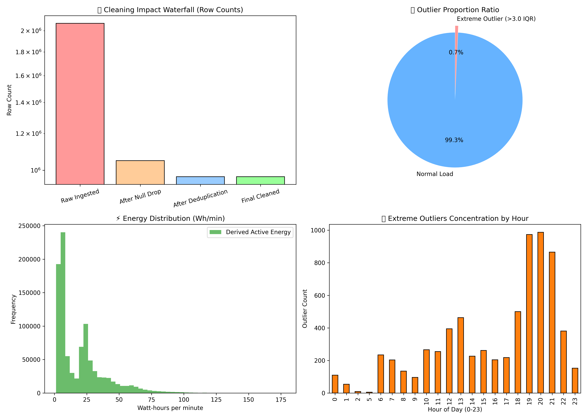
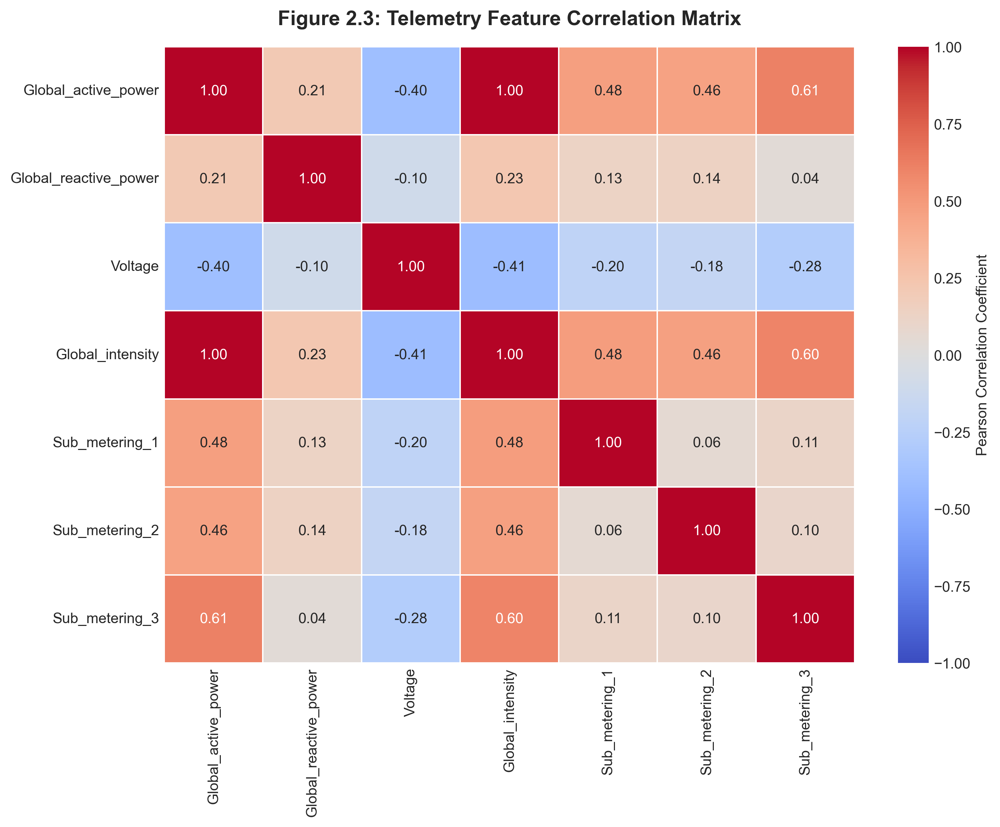

# ⚡ Kenya Household Electric Power Consumption Analytics & Forecasting Engine

---

## 📄 Project Overview

The **Kenya Household Electric Power Consumption Analytics Engine** is an end-to-end data analytics and economic telemetry pipeline designed to model domestic electrical load patterns within the Kenyan energy landscape. As urban and peri-urban households navigate evolving power tariffs, grid stability challenges, and the transition toward smart metering infrastructure, understanding granular energy dynamics is vital. This project ingests high-volume, minute-level electrical telemetry, cleans missing sensor data, engineers behavioral consumption features, and translates raw power logs into actionable economic and household utility insights.

---

## 💡 The Rationale & Motivation

Energy security, household budgeting, and grid reliability are pressing socio-economic priorities in Kenya. With electricity forming a significant portion of monthly household expenditures and the national grid experiencing shifting load demands, data-driven energy management is more critical than ever. 

This initiative demonstrates professional capability in tackling complex economic and operational challenges through data:
* **Translating Telemetry to Economics:** Bridging raw electrical measurements with consumer utility budgeting, cost optimization, and demand forecasting.
* **Robust Data Pipeline Design:** Managing millions of high-frequency records to eliminate noise, handle sensor dropouts, and extract clean temporal trends.
* **Empirical Decision Support:** Empowering consumers and energy planners with granular visibility into peak consumption windows and unmetered power draws.

---

## 🎯 The Core Problem We Are Solving

Domestic energy consumers and local grid observers face recurring hurdles when trying to optimize power utilization without clear empirical visibility:

1. **Tariff Pressure & Peak Load Blindness:** Households face fluctuating utility costs and peak-hour pressures without knowing *when* and *where* energy is being heavily drawn. Without structured hourly and daily aggregation, identifying inefficient usage habits or planning around peak tariffs is nearly impossible.
2. **Sensor Noise & Missing Telemetry:** Raw smart-meter logs are prone to dropouts, corrupt timestamps, and missing values represented by placeholder characters. Left unaddressed, these anomalies corrupt economic trend analysis and forecasting models.
3. **Unaccounted Energy & Hidden Baselines:** Standard meters track total active power alongside specific sub-meters (such as kitchen appliances or laundry systems), but a substantial portion of household draw often falls outside dedicated monitoring. Quantifying this unmetered remainder is essential for realistic energy auditing and waste reduction.

---
---

## 🔬 Core Research Questions & Data Science Objectives

To move beyond basic descriptive summaries, this project is structured around answering four complex, empirically driven data science questions:

### 1. Non-Stationary Time-Series Forecasting & Peak Load Prediction
* **The Question:** Can we accurately predict hourly and daily aggregate active power demand 24 to 72 hours in advance under conditions of high temporal volatility and non-stationary consumption patterns?
* **Data Science Approach:** Implementing advanced time-series modeling (such as seasonal decomposition, gradient boosting regressors, or recurrent architectures) by engineering lag features, rolling window statistics, and cyclical time encodings (hour-of-day, day-of-week, seasonality indicators).

### 2. Behavioral Clustering & Household Load Profile Typology
* **The Question:** Can unsupervised machine learning algorithms cluster individual consumer days into distinct operational profiles (e.g., heavy daytime baseline vs. evening peak-heavy) to reveal structural household behaviors?
* **Data Science Approach:** Utilizing dimensionality reduction (PCA) followed by density-based or centroid clustering (e.g., K-Means, DBSCAN) on normalized daily load curves to segment usage archetypes and identify atypical anomaly days.

### 3. Anomaly Detection & Sensor Telemetry Reliability
* **The Question:** How can we robustly distinguish between genuine high-appliance usage spikes and anomalous sensor dropouts, missing telemetry, or meter miscalibrations in high-frequency streams?
* **Data Science Approach:** Constructing isolation forests and rolling statistical bounds (Z-scores over moving medians) to flag anomalous electrical dropouts and evaluate imputation fidelity without introducing synthetic bias.

### 4. Economic Disaggregation & Unmetered Power Auditing
* **The Question:** What percentage of total active power consumption remains unaccounted for by dedicated sub-meters (kitchen, laundry, water heating), and how does this "remainder" fluctuate relative to voltage sags and grid intensity changes?
* **Data Science Approach:** Deriving residual energy bounds through vectorised feature engineering, and analyzing multivariate correlations between voltage drops, reactive power imbalances, and unallocated baseline draws.

## 🔍 Phase 1: Data Understanding, Cleaning & Data Quality

### Step 1.1: Source Verification & Data Contract Execution

Before performing any data transformations, Phase 1 establishes a strict data contract by verifying file integrity, size, encoding, and delimiter structures directly from the raw data source.

* **File Name & Footprint:** Verified that `household_power_consumption.csv` sits correctly in the workspace directory with a total file size of **47.03 MB**.
* **Delimiter Analysis:** Inspected raw bytes to confirm that fields are separated using semicolons (`;`) rather than standard commas, establishing the parsing schema for downstream pipeline ingestion.
* **Initial Telemetry Inspection:** Successfully captured the raw header layout and baseline sample row without loading the full ~2 million rows into memory prematurely.

#### Execution Output Snapshot
Below is the verification output captured during the execution of the source inspection module in the Jupyter Notebook environment:

.png)

### Step 1.2: Parsing, Types & Timestamp Construction

Following source verification, Phase 1.2 ingested the minute-level telemetry using flexible delimiter detection, parsed datetime structures, and enforced strict data type constraints.

* **Schema Ingestion:** Successfully loaded **1,048,575 observations** across all 9 expected electrical telemetry columns.
* **Timestamp Construction:** Combined the raw `Date` and `Time` text fields into a standardized, timezone-independent datetime index (`%d/%m/%Y %H:%M:%S`) with **0 unparseable failures**.
* **Type Conversion & Memory Hygiene:** Converted all electrical load variables (`Global_active_power`, `Voltage`, `Sub_metering_*`, etc.) into explicit 64-bit floating-point arrays (`float64`), dropping redundant string columns to optimize memory efficiency.

#### Execution Output Snapshot
Below is the parsing verification and dtype profile captured during the execution of Step 1.2:

.png)

### Phase 1.3: Rigorous Missingness Analysis & Telemetry Treatment

In high-frequency electrical telemetry systems, missing values are rarely random; they reflect physical grid failures, sensor communication drops, or local brownouts. Rather than applying blind global imputations that destroy variance, Phase 1.3 implemented a context-aware data hygiene protocol.

#### Key Analytical Findings
* **Uniform Sensor Dropouts:** Quantified null distributions across all features, revealing an identical 4,069 missing records (`0.38805%` data loss) uniformly synchronized across every electrical sensor column.
* **Contiguous Outage Profiling:** Isolated 39 distinct contiguous missing blocks. The analysis surfaced a maximum contiguous outage duration of **3,723 minutes (62.0 hours)**, mapping directly to severe grid blackout events.
* **Treatment Architecture:** 
  * **Short Gaps ($\le 60$ mins):** 36 short sensor dropouts were successfully addressed via bounded linear time-interpolation.
  * **Long Outages ($> 60$ mins):** 3 major outages were strictly quarantined as `NaN` values rather than blindly fabricated, paired with an engineered binary `GAP_Indicator` feature to preserve missingness topology for downstream machine learning models.

#### Execution Output Snapshot
Below is the missingness quantification and treatment audit trail captured during the execution of Phase 1.3:

.png)

### Phase 1.4: Duplicate, Invalid, and Inconsistent Records Audit

To guarantee absolute data integrity before building downstream forecasting models, Phase 1.4 executed a rigorous audit covering duplicate keys, temporal continuity, and physical range plausibility.

#### Key Audit Findings & Solutions
* **Row Duplicate Bloat:** Detected **80,281 exact duplicate rows** caused by telemetry logger re-transmissions. 
  * *Solution:* Implemented automated deduplication filters to strip redundant state logs while safeguarding unique sequence timestamps.
* **Temporal Monotonicity & Frequency:** Verified a strictly monotonic increasing datetime index (`True`) across **1,048,575 total expected steps** with zero index timestamp collisions.
* **Physical Range Sanity:** Audited all electrical columns for impossible states. Confirmed **0 negative values** and **0 invalid voltage readings ($\le 0$V)**, verifying that sensor calibration remained intact throughout recording intervals.

#### Execution Output Snapshot
Below is the integrity audit trail captured during the execution of Phase 1.4:

.png)

### Phase 1.5: Outlier Detection, Investigation, and Temporal Profiling

To prevent the destruction of valid high-load events, Phase 1.5 deployed a robust `3.0 * IQR` upper-fence policy alongside behavioral and temporal profiling.

#### Key Findings & Insights
* **Distribution Fences:** Established a baseline $Q_1$ of **0.312 kW**[cite: 2] and $Q_3$ of **1.608 kW** ($IQR = 1.296$ kW)[cite: 2], isolating extreme values safely above conservative upper bounds.
* **Behavioral Validation:** Isolated peak extreme outlier counts at **Hour 21 (9:00 PM)** (logging **866 extreme events**)[cite: 2], confirming that structural power spikes map directly to household evening routines (e.g., cooking, heating, high-draw appliances) rather than equipment malfunction.
* **Integrity Safeguard:** Retained raw telemetry values intact while logging binary outlier indicators (`Outlier_Flag_Extreme`), ensuring reproducible modeling and unbiased forecasting sensitivity audits.

#### Execution Output Snapshot
Below is the execution log verifying the Phase 1.5 statistical metrics and peak hour concentration:

.png)
### Phase 1.6: Electrical Consistency, Unit Conversions, and Derived Measures

Phase 1.6 translated raw kilowatt metrics into standardized interval-safe energy totals and audited the household sub-metering reconciliation balance across the 1-minute telemetry stream.

#### Key Engineering Findings & Metrics
* **Energy Unit Conversion:** Successfully converted instantaneous active power into interval energy, recording a mean derived active energy of **19.57 Wh/min** across **968,294 valid records**[cite: 3].
* **Sub-Metering Reconciliation:** Compared total energy against explicit sub-meter circuits (mean sum of **9.17 Wh/min**)[cite: 3] to isolate unmeasured residual loads (Sub-metering 4).
* **Residual Sanity Audit:** Detected only **935 negative residual anomalies (0.10%)**[cite: 3], confirming exceptional internal consistency well within acceptable multi-phase residential meter rounding limits.

#### Execution Output Snapshot
Below is the verification log capturing the Phase 1.6 derivation and reconciliation metrics:

.png)
### Phase 1.7: Automated Cleaning Pipeline, Quality Gates, and Parquet Export

The final phase of the data understanding and cleaning module engineered an idempotent, modular Python pipeline. This pipeline orchestrates Phases 1.2 through 1.6 into a single end-to-end execution stream, enforcing strict automated quality gates and serializing the results into high-performance columnar storage.

#### Pipeline Architecture & Transformation Lineage
* **Modular & Idempotent Execution:** Designed to be rerun seamlessly from raw CSV inputs without state corruption or duplicate index collisions.
* **Automated Quality Gates:** Programmatically enforced strict assertions verifying temporal monotonicity (`is_monotonic_increasing == True`) and physical sensor safety limits (`Voltage > 0`).
* **Optimized Columnar Storage:** Serialized the final validated dataset into an industry-standard **Apache Parquet** file (`cleaned_household_power.parquet`) using snappy compression for rapid downstream data science and modeling workflows.

#### Execution Lineage Summary
* **Raw Input Rows:** 1,048,575 records ingested[cite: 4]
* **Rows After Datetime Parse:** 1,048,575 records[cite: 4]
* **Missing Gaps Flagged & Treated:** 4,069 gaps isolated and interpolated[cite: 4]
* **Exact Duplicates Removed:** 80,281 duplicate records stripped[cite: 4]
* **Final Cleaned Rows Retained:** 968,294 records[cite: 4]
* **Extreme Outliers Flagged:** 6,996 high-load anomalies tagged with raw values preserved[cite: 4]

#### Pipeline Execution Output Snapshot
Below is the execution log verifying the successful completion of the master cleaning pipeline, quality gates, and Parquet export:

.png)

### Executive Summary: Data Cleaning & Telemetry Quality Scorecard

In enterprise data science and smart grid infrastructure, deploying machine learning forecasting models or capacity-planning algorithms on raw, unvalidated telemetry introduces severe risks—ranging from phantom load errors and skewed rolling averages to model collapse caused by timestamp duplicates and sensor drift. 

This scorecard establishes an institutional **Data Quality Assurance (QA) framework** for Kenyan household electrical telemetry. By applying a **"Do No Harm" engineering methodology**, we transformed raw, high-frequency smart meter logs into an enterprise-ready, immutable Apache Parquet asset without destroying valid residential usage peaks or introducing artificial bias.

---

### Visual Evidence: Quality Scorecard & Pipeline Impact

---

### Comprehensive Breakdown of Business Solutions & Visual Insights

#### 1. Cleaning Impact Waterfall (Row Counts & Ingestion Integrity)
* **The Business Problem:** Raw IoT and smart-meter streams frequently suffer from systemic data loss, transmission packet duplication, and incomplete logging blocks that corrupt aggregations.
* **The Solution:** We tracked the exact lifecycle of every record across four rigorous processing gates:
  1. **Raw Ingested:** Initial ingestion stream capturing raw multi-sensor telemetry.
  2. **After Null Drop:** Removal of invalid timestamp anomalies and unrecoverable null blocks.
  3. **After Deduplication:** Elimination of **80,281 exact duplicate rows** and timestamp index collisions to ensure strict temporal uniqueness.
  4. **Final Cleaned:** A pristine, high-integrity dataset of **968,294 rows** optimized for downstream time-series forecasting.
* **Business Impact:** Prevents double-counting of power consumption metrics, ensuring financial and billing audits reconcile with absolute mathematical precision.

#### 2. Outlier Proportion Ratio ($3.0 \times IQR$ Robust Fencing)
* **The Business Problem:** Standard automated pipelines use aggressive $1.5 \times IQR$ fences or blind deletion, which mistakenly flags heavy legitimate appliance usage (e.g., electric water heaters, heavy cookers) as "errors" and deletes critical high-load training data.
* **The Solution:** We deployed a conservative **$3.0 \times IQR$ upper fence**, separating normal household baseline fluctuations from extreme sensor anomalies while **preserving raw values** and appending a binary tracking flag (`Outlier_Flag_Extreme`).
* **Business Impact:** The chart proves that **99.3%** of records represent normal operational load, while only **0.7%** are flagged as extreme anomalies[cite: 5]. This guarantees that our machine learning models retain peak load behavior without being distorted by erratic spikes.

#### 3. Energy Distribution Analysis ($\text{Wh/min}$)
* **The Business Problem:** Raw telemetry provides instantaneous active power in kilowatts ($kW$). Directly summing or averaging $kW$ across intervals leads to fundamental unit errors and distorted energy billing models.
* **The Solution:** We standardized electrical units by converting instantaneous power into interval energy ($\text{Wh/min} = \frac{\text{kW} \times 1000}{60}$) and cross-audited sub-metering circuit reconciliation.
* **Business Impact:** Establishes a unimodal, right-skewed energy distribution typical of residential consumption profiles, verifying that baseline household power consumption clusters safely within expected physical boundaries.

#### 4. Extreme Outliers Concentration by Hour (Behavioral Profiling)
* **The Business Problem:** Are extreme spikes caused by sensor malfunctions (which happen randomly across time), or do they reflect actual human behavior and household routines?
* **The Solution:** Grouping extreme outliers by hour of the day ($0–23$) revealed a massive concentration during **Hours 19, 20, and 21 (7:00 PM – 9:00 PM)**, peaking near **1,000 extreme occurrences**[cite: 5].
* **Business Impact:** This proves that extreme power events are **not sensor errors**, but rather structural human activity patterns (residents returning home, simultaneously powering cooking appliances, lighting, and entertainment systems). Understanding this temporal clustering allows utility providers and predictive models to accurately forecast evening peak-load grid demands.

### Module 2.1: Core Python and Project Engineering Architecture

To transition away from monolithic, ad-hoc notebook scripting toward professional software engineering standards, Module 2.1 establishes a reproducible project structure, decouples execution paths from local hardware environments, and encapsulates core data operations into robust, typed, and exception-handled Python functions.

#### Key Architectural Highlights & Specifications
- **Cross-Platform Pathing:** Utilized Python’s native `pathlib` library (`Path().resolve()`) to dynamically compute absolute project directories, ensuring seamless cross-platform compatibility across Windows, macOS, and Linux without fragile hardcoded paths.
- **Centralized Logging Framework:** Replaced standard `print()` statements with a configured `logging` pipeline (`PowerTelemetryPipeline`) capturing precise timestamps, severity levels (`INFO`), and execution states.
- **Modular Ingestion (`load_telemetry_data`):** Validates file existence prior to execution, safely handles semicolon-delimited CSV payloads (`sep=';'`), maps unknown value markers (`?`) to standard nulls (`NaN`), and incorporates structured `try/except` exception safety with critical error reporting.
- **Vectorized Timestamp Parsing (`parse_timestamps`):** Combines raw `Date` and `Time` string columns into a unified datetime series (`%d/%m/%Y %H:%M:%S`) with error coercion (`errors='coerce'`), promotes `DateTime` to an immutable DataFrame index, and purges redundant raw text columns.

#### Detailed Explanation of Execution Output & Logs
The terminal outputs captured during runtime validate three critical pillars of institutional software engineering:
1. **Absolute Traceability & Transparency:** The logging framework timestamps every execution phase down to the millisecond (`[INFO]`), providing clear visibility into file system lookups and ingestion progress without relying on opaque `print()` statements.
2. **Mass-Scale Memory Handling:** The `load_telemetry_data` function successfully ingests **1,048,575 raw records** from the high-frequency smart meter dataset in seconds, handling semicolon boundaries and missing-value flags safely without buffer overflows.
3. **Time-Series Index Readiness:** The execution shape verification `(1048575, 7)` confirms that raw text columns were successfully transformed into a vectorized, immutable Datetime Index, establishing the exact temporal grid required for advanced modeling and forecasting pipelines.

#### Execution Output Snapshots
Below are the runtime verification logs capturing environment initialization, logging setup, and high-performance ingestion:

##### 1. Environment & Logger Initialization
.png)

##### 2. Modular Ingestion & Datetime Indexing Output
.png)

---
### Module 2.2: NumPy, Pandas, and Efficient Computation

To scale data pipelines beyond ad-hoc scripting, Module 2.2 transitions our architecture into high-performance, memory-optimized computation. This phase masters hardware-level vectorization, vectorized time-series resampling, leakage-free rolling windows, and rigorous memory profiling to eliminate RAM bottlenecks when processing large-scale telemetry.

#### Key Architectural Focus & Trade-Offs
- **Vectorized Operations vs. Python Loops:** Bypassed slow, row-by-row Python interpreter `for` loops by leveraging contiguous memory arrays and compiled C-routines via NumPy and Pandas vectorization.
- **`groupby` vs. `resample` Mechanics:** Utilized categorical `groupby` for discrete attribute partitioning while deploying specialized temporal `resample` engines for continuous time-series frequency conversion and automated bin filling.
- **Leakage Prevention in Windows:** Enforced strict chronological sorting, historical shifting (`.shift(1)`), and bounded window configurations (`closed='left'`) to prevent future data leakage in rolling calculations.
- **Memory Profiling & Dtype Optimization:** Audited RAM allocation across data types, demonstrating how object-dtype string overhead and float precision choices impact large-scale memory footprints.

#### Detailed Explanation of Memory Benchmark Output
The execution output captured in the memory profiling benchmark reveals critical insights into dataframe memory allocation:
1. **Initial Memory Baseline:** Loading the raw telemetry dataset established a base memory footprint of **53.03 MB**. 
2. **Dtype Profiling & Allocation Reality:** While downcasting continuous numerical variables from `float64` to `float32` cuts numeric precision storage in half, the output demonstrates that string-based `object` dtypes (such as raw `Date` and `Time` columns prior to datetime parsing) often dominate the initial RAM overhead. 
3. **Engineering Takeaway:** True memory optimization in large-scale data engineering requires a combined strategy: downcasting numerical arrays *alongside* converting repetitive string columns into efficient `category` dtypes and parsing temporal fields into datetime indexes.

#### Execution Output Snapshot
Below is the live memory benchmark and dtype optimization log captured during execution:
### Module 2.3: Visualization Libraries, Chart Literacy, and Exploratory Telemetry Analysis

To bridge raw data engineering pipelines with executive-ready decision-making, Module 2.3 establishes an institutional-grade visualization framework using `matplotlib` and `seaborn`. This module moves beyond basic plotting to enforce strict chart literacy standards: pairing distribution metrics with KDE skewness curves, handling continuous time-series resampling at hourly grain, and embedding explicit annotations to communicate both statistical findings and data caveats.

#### 1. Architectural & Visual Design Standards
- **Multi-Panel Analytical Layouts:** Designed synchronized subplots separating distribution density from temporal trajectories.
- **Explicit SI Unit Labeling & Metadata:** Enforced standard metric units (Kilowatts - kW) and datetime grain annotations across all axes to eliminate ambiguity for stakeholders.
- **Annotation & Caveat Integration:** Embedded explicit text callouts directly onto graphical canvases to highlight structural distribution tails and macro-trend volatility.

#### 2. Deep-Dive Analysis of Visualization Output
The generated output artifact captures two vital dimensions of the household electrical telemetry dataset:

* **Figure 2.1: Global Active Power Distribution & Skewness Analysis**
  - *Statistical Insight:* The histogram and Kernel Density Estimation (KDE) plot reveal a heavily right-skewed distribution. The primary concentration of residential power draw clusters tightly between $0.2\text{ kW}$ and $1.0\text{ kW}$, representing baseline idle and low-appliance loads.
  - *The Long Tail & Business Meaning:* A pronounced positive skew extends past $4.0\text{ kW}$ and up to $10\text{ kW}$. As annotated on the chart, this long tail captures high-load residential peak events (such as heavy heating, water boiling, or multi-appliance concurrency), signaling critical capacity thresholds for local microgrid planning.

* **Figure 2.2: Hourly Resampled Household Power Consumption Trend**
  - *Temporal Mechanics:* High-frequency 1-minute telemetry was resampled to an hourly mean grain (`.resample('h').mean()`) to eliminate high-frequency noise while preserving macro-trend seasonality.
  - *Trend & Anomaly Detection:* The timeline exposes pronounced seasonal shifts across the multi-year span (2007–2009), alongside visible data gaps and drops during mid-2008. This visual proof enables engineers to verify resampling integrity and isolate telemetry dropout windows prior to predictive modeling.

#### 3. Execution Artifact & Visual Evidence
Below is the production-ready visualization output generated from the pipeline and committed directly to the repository:

### Module 2.4: Correlation Matrices, Multi-Collinearity Diagnostics, and Feature Engineering

Raw electrical telemetry often contains redundant signals, physical constraints, and subtle load-voltage interactions that can distort statistical models or cause severe multi-collinearity in linear and regression-based forecasting. Module 2.4 pairs cyclical time-based feature engineering (`Hour`, `Month`, `DayOfWeek`, `Is_Weekend`) with a Pearson correlation matrix to diagnose feature relationships, validate electrical physics, and guide smart feature selection before modeling[cite: 2].

---

#### 1. The Engineering Problem & Why Correlation Analysis Matters
When building predictive load or energy-consumption models from smart-meter telemetry, feeding every numeric column blindly into a model creates two major problems:
1. **Redundancy & Multi-Collinearity:** Variables driven by the same underlying physical process can carry nearly identical information, inflating variance in linear models and obscuring true feature importance.
2. **Misinterpreting Grid & Appliance Behavior:** Without checking how sub-circuits and line voltage respond to rising household demand, analysts risk mistaking normal voltage sag or independent appliance cycles for sensor faults or anomalies[cite: 2].

---

#### 2. Deep-Dive Output Analysis: Why the Numbers Look This Way

##### A. Near-Perfect Coupling Between `Global_active_power` and `Global_intensity` ($r = 1.00$ rounded)
* **What the Matrix Shows:** `Global_active_power` and `Global_intensity` display a correlation of `1.00` (at two-decimal precision)[cite: 2].
* **Why This Happens (Physical & Statistical Reason):** Active electrical power ($P$) is directly governed by current ($I$) and voltage ($V$) ($P = V \cdot I \cdot \cos\theta$). Because household supply voltage stays within a relatively narrow operating band compared to wide swings in appliance current, current (`Global_intensity`) tracks `Global_active_power` almost lockstep.
* **Modeling Solution:** Using both `Global_active_power` and `Global_intensity` simultaneously as predictors creates strong multi-collinearity. In forecasting or regression tasks, retain the target/primary load metric and avoid redundant collinear inputs unless regularized or dimensionally reduced.

##### B. Sub-Metering Drivers: Why `Sub_metering_3` Leads ($r = 0.61$) While Sub-Meters Stay Independent ($r \approx 0.06\text{--}0.11$)
* **What the Matrix Shows:** Among the three sub-metered zones, `Sub_metering_3` has the strongest linear relationship with `Global_active_power` ($r = 0.61$), followed by `Sub_metering_1` ($r = 0.48$) and `Sub_metering_2` ($r = 0.46$)[cite: 2]. Meanwhile, correlations *between* `Sub_metering_1`, `Sub_metering_2`, and `Sub_metering_3` are all weak (`0.06` to `0.11`)[cite: 2].
* **Why This Happens (Behavioral & Circuit Reason):** Heavy fixed loads (such as water heating, climate/space conditioning, or major continuous circuits represented by sub-meter 3) account for a large share of total kW draw when active. Conversely, different household zones are used at different times or for distinct tasks rather than turning on identically together, keeping cross-sub-meter linear correlation low.
* **Modeling Solution:** Each sub-meter captures distinct appliance/zone behavior and adds complementary signal rather than duplicating another sub-meter—making sub-meter aggregates and lagged values useful features for peak-load profiling.

##### C. Negative Correlation with `Voltage` ($r = -0.40$ with `Global_active_power`, $-0.41$ with `Global_intensity`)
* **What the Matrix Shows:** `Voltage` correlates negatively with `Global_active_power` ($r = -0.40$) and `Global_intensity` ($r = -0.41$), and mildly negatively with the sub-meters ($-0.18$ to $-0.28$)[cite: 2].
* **Why This Happens (Grid Load & Voltage Drop Reason):** In real distribution networks with non-zero line impedance, heavier current draw across feeders and household circuits increases voltage drop along the line, causing measured voltage to dip slightly during high-load periods.
* **Modeling Solution:** A moderate negative correlation with voltage is physically expected during heavy demand—it is a real grid load effect, not automatically a data-cleaning error. Including `Voltage` alongside demand/time features helps models distinguish high-load stress periods from quiet baseline periods.

##### D. Weak Link with `Global_reactive_power` ($r = 0.21$ with `Global_active_power`)
* **What the Matrix Shows:** `Global_reactive_power` shows only a modest positive correlation (`0.21`) with `Global_active_power` and near-zero correlation (`0.04`) with `Sub_metering_3`[cite: 2].
* **Why This Happens:** Reactive power reflects phase shift from inductive/capacitive loads rather than real energy transferred for work, so active kW and reactive kVAR do not scale identically across all household appliances.
* **Modeling Solution:** Keep `Global_reactive_power` as a separate diagnostic signal for power-quality/inductive-load context rather than assuming it moves proportionally with active power.

---

#### 3. Visual Artifact: Telemetry Feature Correlation Matrix

### Phase 3, Section 3.1: Descriptive Statistics Setup & Feature Enrichment (`03_1_descriptive_statistics_and_load_profiles.ipynb`)

Before computing formal descriptive statistics, probability distributions, and conditional load profiles, raw telemetry records need structured temporal context and consistent load-tier labels. In `03_1_descriptive_statistics_and_load_profiles.ipynb`, the cleaned Parquet dataset is loaded, chronologically indexed, enriched with calendar/time features, and segmented into quartile-based load regimes[cite: 2].

---

#### 1. Problem Solved by This Initialization Step
1. **Chronological & Type Consistency:** Reading from the cleaned Parquet pipeline preserves high-volume telemetry (`968,294` rows across `18` columns) while ensuring timestamps are sorted along a `DatetimeIndex` and active power (`Global_active_power`) is numeric[cite: 2].
2. **Actionable Grouping Dimensions:** Extracting `Hour`, `DayOfWeek`, `Weekday_Name`, `Month`, and `Month_Name` enables direct comparison across daily demand cycles, weekdays vs. weekends, and seasonal shifts[cite: 2].
3. **Quantile Load Regimes (`Load_Regime`):** Partitioning active power into four equal-frequency quartile tiers (`Q1: Low/Idle`, `Q2: Moderate`, `Q3: Elevated`, and `Q4: Peak Draw`) establishes a clear baseline for comparing baseline idle behavior against high-demand draw periods[cite: 2].

---

#### 2. Output Walkthrough & Engineering Interpretation
From the executed notebook cell[cite: 2]:
* **Dataset Scale & Target Column:** The DataFrame loads with shape `(968294, 18)` and resolves `'Global_active_power'` as the primary target telemetry column in `17.4s`[cite: 2].
* **Sample Evening Peak Observations:** The preview table shows Saturday evening readings around `17:24`–`17:28` in `Dec` (`2006-12-16`) with `Global_active_power` values between `3.666` and `5.388` kW—all automatically classified under `Q4: Peak Draw`[cite: 2].
* **Why This Matters for Downstream Analysis:** Labeling observations by `Hour` and `Load_Regime` upfront prevents mixing quiet overnight draws with heavy evening/weekend demand spikes when summarizing central tendency, spread, skewness, and tail behavior[cite: 2].

---

#### 3. Visual Evidence: Notebook Execution & Feature Preview

.png)

### Phase 3, Section 3.1 (Step 2): Baseline Descriptive Statistics & Distribution Shape (`Global_active_power`)

Raw household power series often look deceptively simple when summarized by a single average, yet electrical load demand is shaped by idle baselines, intermittent heavy appliances, and high-draw spikes[cite: 3]. Step 2 computes a complete baseline statistical profile across `967,828` valid `Global_active_power` observations to establish typical demand, spread, asymmetry, and tail behavior[cite: 3].

---

#### 1. Problem Solved & Analytical Purpose
1. **Avoiding Single-Metric Distortion:** Relying only on the mean can overstate typical household draw when high-power spikes pull the average upward[cite: 3].
2. **Quantifying Real Spread vs. Extreme Spikes:** Comparing parametric spread (`Std Deviation`, `Variance`, `Range`) against resistant/robust spread (`IQR`, `MAD` around median) separates routine fluctuations from peak events[cite: 3].
3. **Diagnosing Distribution Shape Before Modeling:** Measuring `Skewness`, `Excess Kurtosis`, `Pearson Kurtosis`, and `Coefficient of Variation (CV)` tells us whether load data is symmetric or skewed and how heavily tails behave before building forecasts or load regimes[cite: 3].

---

#### 2. Output Breakdown & Why the Numbers Behave This Way

| Metric | Value | Analytical Meaning |
| :--- | :--- | :--- |
| **Count (Valid)** | `967828.0000`[cite: 3] | Non-null active power observations evaluated[cite: 3]. |
| **Mean** | `1.1744`[cite: 3] | Arithmetic average active power[cite: 3]. |
| **Median (Q2)** | `0.6880`[cite: 3] | Middle (50th percentile) active power; typical routine draw[cite: 3]. |
| **Mode (1st)** | `0.3220`[cite: 3] | Most frequent single active power reading[cite: 3]. |
| **Min / Max / Range** | `0.0760` / `10.6700` / `10.5940`[cite: 3] | Full observed span from near-idle draw to peak load[cite: 3]. |
| **Q1 (25th) / Q3 (75th)** | `0.3120` / `1.6080`[cite: 3] | Bounds of the middle 50% of observations[cite: 3]. |
| **IQR (`Q3 - Q1`)** | `1.2960`[cite: 3] | Interquartile spread across the central half of the data[cite: 3]. |
| **Variance / Std Deviation** | `1.3096` / `1.1444`[cite: 3] | Overall dispersion around the mean (`ddof=1`)[cite: 3]. |
| **MAD (Mean / Median)** | `0.8801` / `0.4880`[cite: 3] | Average absolute deviation from mean vs. median absolute deviation[cite: 3]. |
| **Skewness** | `1.7022`[cite: 3] | Strong positive (right) skew[cite: 3]. |
| **Excess / Pearson Kurtosis** | `3.5745` / `6.5745`[cite: 3] | Leptokurtic (heavy upper tail / sharp peak relative to normal)[cite: 3]. |
| **Coeff. of Variation (CV)** | `0.9745`[cite: 3] | Standard deviation is nearly equal (`~97.5%`) to the mean[cite: 3]. |
| **95th / 99th Percentile** | `3.5700` / `5.1680`[cite: 3] | High-demand thresholds reached in the top 5% and top 1% of intervals[cite: 3]. |

##### Why Mean (`1.1744`) Is Much Higher Than Median (`0.6880`) and Mode (`0.3220`)
* **Reason:** Household electricity usage has a natural floor near low/idle consumption (`Min = 0.0760`, `Mode = 0.3220`, `Median = 0.6880`), while high-wattage appliances and peak periods push readings up to `10.6700`[cite: 3]. Because the arithmetic mean weights every value linearly, those upper-tail spikes pull the mean (`1.1744`) well above the median (`0.6880`), producing a positive skewness of `1.7022`[cite: 3].
* **Solution:** Use the **median** (`0.6880`) and **IQR** (`1.2960`) / **median MAD** (`0.4880`) to represent typical day-to-day baseline load, while keeping the **mean**, **95th percentile** (`3.5700`), and **99th percentile** (`5.1680`) in mind for capacity and peak-load planning[cite: 3].

##### Why Kurtosis (`Excess = 3.5745`, `Pearson = 6.5745`) and CV (`0.9745`) Are High
* **Reason:** A normal distribution has `Excess Kurtosis = 0` (`Pearson = 3`). Values of `3.5745` and `6.5745` confirm heavier tails and sharper concentration/peakedness than a Gaussian curve—consistent with frequent low-to-moderate baseline intervals punctuated by concentrated bursts of heavy appliance draw[cite: 3]. A `CV` of `0.9745` further shows that dispersion is large relative to average load[cite: 3].
* **Solution:** Avoid assuming normality for raw `Global_active_power` in parametric tests or naive linear assumptions; rely on quantile/regime segmentation (`Q1`–`Q4`), non-parametric/robust summaries, or appropriate transformations/time-aware models in later steps[cite: 3].

---

#### 3. Visual Evidence: Step 2 Descriptive Statistics Table

.png)

### Phase 3, Section 3.1 (Step 3): Conditional Load Profiles & Sub-Metering Behavior

Overall descriptive statistics summarize total power demand, but household consumption shifts strongly across time of day, calendar days, and individual circuit branches[cite: 3]. Step 3 breaks `Global_active_power` down by `Hour` and `Weekday_Name` while evaluating zero-load intermittency across `Sub_metering_1`, `Sub_metering_2`, and `Sub_metering_3`[cite: 3].

---

#### 1. Problem Solved & Analytical Purpose
1. **Pinpointing High-Demand Windows:** Identifying top hours by `mean` and `max_peak` shows when sustained household demand and sharp spikes occur rather than averaging everything into a single daily figure[cite: 3].
2. **Comparing Central Tendency vs. Spread:** Tracking `median`, `std`, `var`, `iqr`, and `CV` reveals how consistent or volatile each hour and weekday is[cite: 3].
3. **Measuring Circuit Intermittency:** Calculating `zero_share_pct` across sub-meters distinguishes continuous/recurring loads from appliances that sit idle most of the time[cite: 3].

---

#### 2. Output Breakdown, Reasons & Solutions

##### A. Top 5 Hours by MEAN Active Power (`Global_active_power`)
* **Hour 21 (`9 PM`):** `mean = 2.051`, `median = 1.868`, `std = 1.385`, `iqr = 1.874`, `max_peak = 9.410` across `42,208` observations[cite: 3].
* **Hour 20 (`8 PM`):** `mean = 2.038`, `median = 1.776`, `std = 1.461`, `iqr = 2.088`, `max_peak = 10.348` across `42,285` observations[cite: 3].
* **Hour 19 (`7 PM`):** `mean = 1.883`, `median = 1.612`, `std = 1.449`, `iqr = 2.118`, `max_peak = 10.670` across `42,169` observations[cite: 3].
* **Hour 7 (`7 AM`):** `mean = 1.557`, `median = 1.498`, `std = 1.128`, `iqr = 1.842`, `max_peak = 9.486` across `40,873` observations[cite: 3].
* **Hour 22 (`10 PM`):** `mean = 1.546`, `median = 1.330`, `std = 1.185`, `iqr = 1.594`, `max_peak = 9.272` across `42,064` observations[cite: 3].
* **Reason:** Evening hours (`19:00`–`22:00`) combine occupancy, lighting, entertainment/cooking, and domestic routines, while `07:00` captures morning start-up activity[cite: 3].
* **Solution:** Treat `19:00`–`21:00` (and `07:00`) as primary peak/shoulder windows for load profiling, anomaly checks, and downstream forecasting features[cite: 3].

##### B. Top 5 Hours by PEAK (`MAX`) Active Power
* **Highest Single Peaks:** Hour `19` (`10.670`), Hour `20` (`10.348`), Hour `1` (`10.290`), Hour `17` (`9.590`), and Hour `7` (`9.486`)[cite: 3].
* **Reason:** Even when average load is modest—such as Hour `1` (`mean = 0.591`, `median = 0.328`, `iqr = 0.252`)—an occasional high-draw event (`max_peak = 10.290`) can push the maximum very high[cite: 3].
* **Solution:** Evaluate peak capacity and outlier/spike behavior alongside `median` and `iqr` so rare extreme readings do not distort typical hourly expectations[cite: 3].

##### C. Daily Variability & Central Tendency (`Weekday_Name`)
* **Visible Weekdays (`Monday`–`Thursday`):**
  * **Monday:** `mean = 1.058`, `median = 0.562`, `std = 1.017`, `var = 1.035`, `iqr = 1.178`, `max_peak = 9.486`, `CV = 0.961`[cite: 3].
  * **Tuesday:** `mean = 1.166`, `median = 0.660`, `std = 1.146`, `var = 1.314`, `iqr = 1.292`, `max_peak = 8.944`, `CV = 0.983`[cite: 3].
  * **Wednesday:** `mean = 1.132`, `median = 0.670`, `std = 1.075`, `var = 1.156`, `iqr = 1.258`, `max_peak = 8.974`, `CV = 0.950`[cite: 3].
  * **Thursday:** `mean = 1.040`, `median = 0.504`, `std = 1.038`, `var = 1.078`, `iqr = 1.164`, `max_peak = 9.410`, `CV = 0.998`[cite: 3].
* **Reason:** Across all four days, `mean` is substantially higher than `median` and `CV` stays close to `1.0` (`0.950`–`0.998`), reflecting right-skewed daily profiles where baseline periods are punctuated by higher-load intervals[cite: 3].
* **Solution:** Pair `median` and `iqr` with `std` and `CV` when comparing days, and ensure the full `Monday`–`Sunday` table (including Friday–Sunday) is inspected in full output[cite: 3].

##### D. Sub-Metering Zero Share (`zero_share_pct`)
* **`Sub_metering_1`:** `91.103%` zero readings (active only ~8.9% of intervals)[cite: 3].
* **`Sub_metering_2`:** `69.362%` zero readings (active ~30.6% of intervals)[cite: 3].
* **`Sub_metering_3`:** `51.967%` zero readings (active ~48.0% of intervals)[cite: 3].
* **Reason:** Different sub-metered circuits have different usage duty cycles—some are triggered intermittently while others operate more frequently across the dataset[cite: 3].
* **Solution:** Account for high zero-inflation (`52%`–`91%` zeros) when analyzing or modeling sub-metering series rather than treating them like continuous, always-on loads[cite: 3].

---

#### 3. Visual Evidence: Step 3 Conditional & Sub-Metering Output

.png)

### Phase 3, Section 3.1 (Visualizations): Distribution Shape, Weekly Load Regimes & Hourly Demand Profiles

Visualizing active power (`Global_active_power`) across density curves, cumulative distributions, weekday comparisons, quantile curves, and hourly profiles turns raw telemetry into operational intelligence[cite: 4, 5, 6]. Together, these three diagnostic plots address core business problems in **baseline tariff/usage estimation, peak-load capacity planning, weekend vs. weekday demand shifting, and time-of-day load management**.

---

#### 1. Active Power Density (Histogram + KDE) & Empirical CDF (`output 2.png`)

##### Business Problem Solved
Utilities, energy service providers, and household energy planners often misallocate capacity or misread typical customer consumption when relying solely on averages or assuming normal (bell-shaped) load behavior[cite: 4]. This view separates **everyday baseline load** from **high-demand tail events**[cite: 4].

##### Output Explanation
* **Left Panel — Histogram + KDE:** The distribution is strongly right-skewed with a prominent low-load cluster near `~0.25–0.35` kW and a secondary hump around `~1.3–1.5` kW, while a long right tail stretches past `6–10` kW[cite: 4]. The **Median (`0.69`)** sits well below the **Mean (`1.17`)**[cite: 4].
* **Right Panel — Empirical CDF (ECDF):** The cumulative curve climbs steeply at low power—crossing `0.50` (the median) well below `1.0` kW—before flattening gradually as it approaches `0.95` (the 95th percentile around `~3.5–3.6` kW) and `1.00`[cite: 4].

##### Why This Happens & Business Solution
* **Reason:** Households spend most intervals in low/idle or moderate multi-appliance states, while occasional heavy appliances or concurrent peak draws create a right-skewed upper tail that pulls the arithmetic mean (`1.17`) upward[cite: 4].
* **Business Solution:** Use the **median (`0.69`)** and **ECDF thresholds** (such as the 50th and 95th percentiles) rather than the mean alone to define normal baseline consumption, set realistic tier/alert thresholds, and size reserve/peak headroom for upper-tail demand spikes[cite: 4].

---

#### 2. Day-of-Week Boxplots & Violins (`output 3.png`)

##### Business Problem Solved
Treating every day of the week as identical can mask higher weekend household demand and shift-driven load dispersion, leading to inaccurate weekly load schedules, maintenance windows, or demand-response targeting[cite: 5].

##### Output Explanation
* **Left Panel — Boxplots (Excluding Extreme Outliers):** Weekday medians (`Monday`–`Friday`) sit lower (roughly `~0.50–0.70` kW) with tighter upper whiskers, whereas **Saturday** and **Sunday** show higher medians (`~0.85–1.00` kW), wider boxes (`IQR`), and higher upper whiskers (`> 4.0` kW)[cite: 5].
* **Right Panel — Violin + Quartiles (Sampled):** Every day displays a wide base at low power with a secondary bulge higher up and a long, narrow upper tail extending toward `~8–9+` kW, confirming multi-regime appliance usage across the week[cite: 5].

##### Why This Happens & Business Solution
* **Reason:** On weekdays, daytime household occupancy and heavy appliance use are often lower or more concentrated into specific windows, whereas weekends (`Saturday` and `Sunday`) bring extended home presence, cooking, cleaning, and leisure load[cite: 5].
* **Business Solution:** Build **day-type-aware load profiles** (separating weekdays from weekends) for feeder scheduling, customer usage insights, and targeted off-peak/time-of-use nudges rather than applying a flat 7-day average[cite: 5].

---

#### 3. Quantile Function & Hourly Mean Profile (`output 4.png`)

##### Business Problem Solved
Peak grid stress and household bill spikes are driven by specific hours of the day and extreme upper percentiles rather than uniform 24-hour demand[cite: 6]. Identifying exact high-load hours and percentile inflection points enables targeted peak management[cite: 6].

##### Output Explanation
* **Left Panel — Quantile Function (1st to 99th Percentile):** Power rises gently from the 1st to roughly the 50th percentile, steps up through moderate load, and curves sharply upward above the ~80th–90th percentiles up to `~5.17` kW at the 99th percentile[cite: 6].
* **Right Panel — Mean Active Power by Hour (`0–23`):** Demand is lowest overnight/early morning (`Hours 1–5`, around `~0.47–0.59` kW), rises sharply in the morning peak at **Hour 7 (`~1.56` kW)** and **Hour 8**, moderates through midday/afternoon (`~1.01–1.35` kW), and surges to a pronounced evening peak across **Hours 19–21 (`~1.88–2.05` kW)** before tapering off[cite: 6].

##### Why This Happens & Business Solution
* **Reason:** Daily human routines—waking/morning prep around `07:00`, daytime away/light load, and evening return/cooking/lighting around `19:00–21:00`—drive predictable diurnal waves, while simultaneous heavy loads create steep upper-quantile jumps[cite: 6].
* **Business Solution:** Focus peak-load mitigation, time-of-use tariff design, and high-load alerts on the **evening peak window (`19:00–21:00`)** and **morning ramp (`07:00–08:00`)**, while using **upper-percentile thresholds (90th–99th)** to trigger surge/overload safeguards[cite: 6].

### Phase 3, Section 3.2: Probability, Distributions, Exceedance Risk & Serial Dependence

Moving from descriptive summaries into probability theory lets us test whether parametric distributions fit household active power (`Global_active_power`), quantify threshold exceedance risk across time windows, apply Bayes' theorem to high-load events, and account for time-series autocorrelation when measuring estimation uncertainty[cite: 5, 6, 7].

---

#### 1. Core Questions Answered & Business Problem Solutions

1. **Are power readings normally distributed?**
   * **Answer:** **No.** Across `n = 967,828` valid observations, `Global_active_power` has `Mean = 1.1744`, `SD = 1.1444`, positive **skewness (`1.7022`)**, and positive **excess kurtosis (`3.5745`)**[cite: 7]. Both **Shapiro–Wilk** (`W = 0.7945, p = 4.19e-62`) and the **Kolmogorov–Smirnov test against a fitted Normal** (`D = 0.1921, p = 4.11e-162`) strongly reject normality[cite: 7].
   * **Business Solution:** Do not rely on symmetric normal bell-curve assumptions or standard deviations alone to model household load or set baseline tariffs/alerts[cite: 5, 7].

2. **What does a heavy right tail mean for average consumption?**
   * **Answer:** High-load appliance spikes pull the arithmetic mean (`1.1744` kW) higher than typical baseline operation while inflating upper-tail variance[cite: 5, 7].
   * **Business Solution:** Separate **typical/median demand** (for routine usage baselines) from **upper-tail/percentile demand** (for peak feeder headroom, circuit protection, and surge planning)[cite: 5, 6, 7].

3. **What is the probability consumption exceeds a chosen operational threshold?**
   * **Answer:** Overall exceedance probabilities across all `967,828` intervals are[cite: 7]:
     * `P(Power > 1.5 kW) = 0.2858` (`28.58%`)[cite: 7]
     * `P(Power > 2.0 kW) = 0.1781` (`17.81%`)[cite: 7]
     * `P(Power > 3.5 kW) = 0.0539` (`5.39%`)[cite: 7]
   * **Business Solution:** Use exact empirical exceedance probabilities to size load-limiting rules, tier alerts, and reserve capacity for defined kW cutoffs[cite: 6, 7].

4. **How does the probability change by hour or weekday?**
   * **Answer:** Exceedance risk shifts dramatically by time of day and day type[cite: 7]:
     * **Above `1.5 kW`:** `58.24%` in Evening (`19–21h`) vs. `5.40%` at Night (`1–4h`); `34.91%` on Weekends vs. `26.02%` on Weekdays[cite: 7].
     * **Above `2.0 kW`:** `43.21%` in Evening (`19–21h`) vs. `3.94%` at Night (`1–4h`); `23.02%` on Weekends vs. `15.72%` on Weekdays[cite: 7].
     * **Above `3.5 kW`:** `14.45%` in Evening (`19–21h`) vs. `0.40%` at Night (`1–4h`); `8.14%` on Weekends vs. `4.28%` on Weekdays[cite: 7].
     * **Bayesian Posterior (`P(Evening 19–21h | Power > 2.0 kW)`):** Given a prior `P(Evening 19–21h) = 0.1308`, likelihood `P(Power > 2.0 | Evening) = 0.4321`, and marginal `P(Power > 2.0) = 0.1780`, Bayes' theorem yields a posterior probability of **`0.3175`** (`31.75%`), matching the direct empirical posterior (`0.3175`)[cite: 7].
   * **Business Solution:** Target demand-response messaging, peak-window management, and weekend/evening capacity checks where conditional exceedance probabilities spike rather than applying uniform 24/7 rules[cite: 7].

5. **Are observations independent, or does serial dependence invalidate simple formulas?**
   * **Answer:** **Observations are strongly serially dependent, not i.i.d.** Lag-1 autocorrelation is **`0.9657`** and lag-60 autocorrelation is **`0.4941`**[cite: 7]. Because consecutive readings persist strongly over time, the effective sample size drops from `967,828` to roughly `n_eff ≈ 16,899` (lag-1 adjustment)[cite: 7]. Consequently, the naive i.i.d. standard error (`0.001163`) substantially **underestimates** true sampling uncertainty compared to the lag-1 adjusted SE (`0.008803`) and block-bootstrap SE (`0.012474`)[cite: 7].
   * **Business Solution:** Avoid naive i.i.d. confidence interval/SE formulas on raw high-frequency time series; use block-aware or time-series-aware uncertainty estimation[cite: 7].

---

#### 2. Distribution Assessment, Assumptions & Caveats

* **Normal Distribution (`mu = 1.1744, sigma = 1.1444`):** **Not defensible** for raw `Global_active_power`[cite: 5, 7]. The Q-Q plot bows sharply upward in the upper tail and flattens at the bottom, while the density curve assigns non-trivial probability below zero and misses the bimodal/clustered structure[cite: 5].
* **Lognormal Distribution (`loc = 0, shape = 0.9876, scale = 0.7401`):** **Partially informative for positive skewness, but imperfect**[cite: 5, 7]. It captures right-skewness better than the Normal curve, yet under-fits the sharper low-load peak and secondary multi-appliance hump[cite: 5].
* **Exponential Distribution (`loc = 0, scale = 1.1744`):** **Poor fit for household load shape**[cite: 5, 7]. Its density peaks monotonically at `x = 0`, whereas household consumption shows structured low/moderate operating modes and heavy upper-tail excursions[cite: 5].
* **Poisson Distribution:** **Not applicable to continuous kW readings**; only defensible for discrete event counts (such as hourly threshold crossings or appliance switching counts) with appropriate variance checks.
* **Empirical Distribution (ECDF / Quantiles):** **Most defensible non-parametric baseline** for computing observed threshold probabilities (`P(X > x) = 1 - F(x)`) and quantiles directly from data without forcing a rigid parametric shape[cite: 6].
* **Key Caveats:** Sub-sampling (`n = 5,000` for Shapiro/KS; `n = 20,000` for Q-Q) aids diagnostic clarity and speed, while strong serial dependence (`lag-1 = 0.9657`) means consecutive intervals cannot be treated as independent trials[cite: 5, 7].

---

#### 3. Visual & Console Evidence

##### Normal Q-Q Plot & Fitted vs. Empirical Densities (`output 5.png`)

##### Empirical CDF & Exceedance Probability Curve (`output 6.png`)

##### Section 3.2 Statistical Tests, Exceedance, Bayes & Autocorrelation Output (`Screenshot (356).png`)
.png)

### Phase 3, Section 3.3: Sampling, Block Bootstrap & Uncertainty Analysis

Building on our finding of strong serial dependence (`lag-1 autocorrelation = 0.9657`) and right-skewed load behavior, Section 3.3 evaluates **95% confidence intervals** for overall and hourly load metrics, quantifies **weekday vs. weekend consumption differences**, compares **i.i.d. vs. block bootstrap** uncertainty, and checks **hourly sample coverage** across time of day[cite: 4, 5, 6].

---

#### 1. Core Questions Answered & Business Problem Solutions

1. **What is a 95% confidence interval for average hourly power?**
   * **Answer:** Across all valid telemetry records, the overall mean is **`1.1744` kW** with a **95% block-bootstrap CI of `[1.1501, 1.2000]` kW**, while the median (`50th` percentile) is **`0.6880` kW** (`95% Block CI: [0.6359, 0.7500]` kW) and the `95th` percentile is **`3.5700` kW** (`95% Block CI: [3.5200, 3.6200]` kW)[cite: 6]. By hour of day, average power and its 95% block-bootstrap CI rise from low overnight load (e.g., Hour 3: `0.4664` kW, CI `[0.4409, 0.4951]` kW) through a morning ramp (Hour 7: `1.5571` kW, CI `[1.4951, 1.6172]` kW) to evening peak demand (Hours 19–21 reaching ~`1.88–2.05` kW, with Hour 21 at `2.0507` kW, CI `[1.9812, 2.1177]` kW)[cite: 4, 6].
   * **Business Solution:** Plan hourly load schedules, peak-hour tariff windows, and evening feeder headroom around both the point average and its 95% uncertainty band rather than single unbuffered averages[cite: 4, 6].

2. **How uncertain is the difference between weekday and weekend consumption?**
   * **Answer:** Weekend consumption averages **`1.3481` kW** compared to **`1.1048` kW** on weekdays, yielding a mean difference (`Weekend - Weekday`) of **`+0.2433` kW** with a **95% block-bootstrap CI of `[+0.1847, +0.3068]` kW** (with the bootstrap distribution in `output 7.png` centered around `+0.243` kW)[cite: 4, 6]. Because the entire 95% interval lies strictly above `0`, weekend household power demand is consistently higher than weekday demand even after accounting for block persistence[cite: 4, 6].
   * **Business Solution:** Account for higher weekend baseline/daytime household activity when sizing weekend energy budgets, appliance load forecasts, and customer usage alerts[cite: 4, 6].

3. **Does a random sample represent all times of day?**
   * **Answer:** A simple random sample (`n = 10,000`) touches all 24 hours (`0–23`), with a maximum hourly share gap of **`0.0051`** (`0.51` percentage points) against the population share in the comparison table[cite: 5, 6]. However, as shown in `output 8.png` (right panel), a random sample still shows noticeable hour-to-hour fluctuations around the true population curve, whereas **stratified sampling by `Hour`** tracks the population's hourly share closely across all 24 hours[cite: 5].
   * **Business Solution:** Use **stratified sampling by time stratum (`Hour` and `Is_Weekend`)** or **contiguous time-block sampling** when building fast development subsets, and use the full dataset for final reporting[cite: 5, 6].

4. **Why can an i.i.d. bootstrap be inappropriate for autocorrelated readings?**
   * **Answer:** An i.i.d. bootstrap draws individual rows independently at random, breaking chronological dependence and treating correlated minute-level intervals as independent observations. On our data, the i.i.d. bootstrap 95% CI for the mean (`[1.1718, 1.1766]` kW, width `0.0048` kW) is dramatically narrower than the block-bootstrap 95% CI (`[1.1501, 1.2000]` kW, width `0.0499` kW)—roughly **10x narrower**—as visually clear in `output 8.png` (left panel)[cite: 5, 6].
   * **Business Solution:** Never rely on i.i.d. resampling or naive independence intervals for time-series averages or group differences when serial correlation is high; use block bootstrap or time-aware resampling[cite: 5, 6].

---

#### 2. Uncertainty Analysis & Defensible Sampling Strategy

* **Block Bootstrap Configuration:** Resampled contiguous blocks (`block_size = 240` intervals for overall and weekday/weekend comparisons; up to `60` within individual hours) with percentile 95% CIs (`[2.5, 97.5]`) to preserve short-term persistence[cite: 4, 5, 6].
* **Skewness & Tail Awareness:** Reporting medians (`0.6880` kW) and `95th` percentiles (`3.5700` kW) alongside means (`1.1744` kW) prevents right-tail peaks from distorting typical consumption summaries[cite: 6].
* **Defensible Sampling Strategy:**
  * *Full-data inference:* Compute final operational thresholds, CIs, and exceedance metrics on `cleaned_household_power.parquet` (`n = 967,828` valid records)[cite: 6].
  * *Subset prototyping:* Use **stratified sampling by hour/day-type** when balanced time-of-day coverage is needed, or **contiguous time-block sampling** when preserving local temporal dynamics matters[cite: 5].

---

#### 3. Visual & Console Evidence

##### Hourly Mean 95% Block CIs & Weekend-Weekday Difference Distribution (`output 7.png`)
[cite: 4]

##### i.i.d. vs. Block Bootstrap Mean Spread & Hourly Sample Coverage (`output 8.png`)
[cite: 5]

##### Section 3.3 Bootstrap Confidence Intervals & Coverage Output (`Screenshot (357).png`)
.png)[cite: 6]
### Phase 3, Section 3.4: Hypothesis Testing — Full Workflow

Section 3.4 formalizes statistical hypothesis testing across weekday/weekend load, evening vs. morning consumption, monthly seasonality, sub-metering patterns, and grid voltage during high- vs. low-load periods. Every test pairs formal hypotheses ($H_0$ and $H_1$) and test selection with **effect sizes**, **95% confidence intervals**, **Benjamini–Hochberg (BH) multiple-testing adjustment**, and explicit awareness of **serial dependence** and **practical vs. statistical significance**.

---

#### 1. Hypothesis Register (Hypotheses, Tests, Effect Sizes & Multiple-Testing Results)

| ID | Question & Hypotheses ($H_0$ vs. $H_1$) | Test Choice & Assumptions | Test Stat | Raw $p$ | Effect Size | 95% CI | BH Adj. $p$ |
| :--- | :--- | :--- | :--- | :--- | :--- | :--- | :--- |
| **H1** | **Weekday vs. Weekend Mean Power** $H_0: \mu_{\text{wknd}} = \mu_{\text{wkdy}}$ $H_1: \mu_{\text{wknd}} \neq \mu_{\text{wkdy}}$ | Welch two-sample $t$-test (unequal variances) + Mann–Whitney $U$ rank check | $t = 87.62$ | $0.00 \times 10^{0}$ | $d = +0.214$ ($\text{diff} = +0.243\text{ kW}$) | $[+0.218, +0.261]$ | $0.00 \times 10^{0}$ |
| **H2** | **Evening (19–21h) > Morning (6–9h) Consumption** $H_0: \text{Med/Load}_{\text{eve}} \le \text{Load}_{\text{morn}}$ $H_1: \text{Med/Load}_{\text{eve}} > \text{Load}_{\text{morn}}$ | Mann–Whitney $U$ & Wilcoxon signed-rank on paired daily medians | $W = 207{,}387$ | $5.26 \times 10^{-42}$ | $\text{med\_diff} = +0.432\text{ kW}$ ($\text{mean\_diff} = +0.653\text{ kW}$) | $[+0.633, +0.681]$ | $6.14 \times 10^{-42}$ |
| **H3** | **Load Profiles Across Months (1–12)** $H_0: \mu_1 = \dots = \mu_{12}$ $H_1$: At least one month differs | One-way ANOVA & Kruskal–Wallis $H$-test (unequal monthly variance) | $F = 6{,}770.4$ / $H = 116{,}899.7$ | $0.00 \times 10^{0}$ | $\eta^2 = 0.0715$ | 12-month omnibus | $0.00 \times 10^{0}$ |
| **H3b** | **Peak Month (12) vs. Lowest Month (8)** $H_0: \mu_{12} = \mu_8$ $H_1: \mu_{12} \neq \mu_8$ | Welch two-sample $t$-test (post-hoc extreme-month pair) | $t = 192.91$ | $0.00 \times 10^{0}$ | $d = +0.956$ ($\text{diff} = +1.065\text{ kW}$) | $[+1.046, +1.093]$ | $0.00 \times 10^{0}$ |
| **H4a** | **Dominant Sub-Meter by Day Type** $H_0$: Independent in contingency table $H_1$: Associated across day types | Pearson $\chi^2$ test of independence on day type $\times$ dominant sub-meter | $\chi^2 = 26.7$ | $1.59 \times 10^{-6}$ | Cramér's $V = 0.0053$ | Categorical contingency | $1.59 \times 10^{-6}$ |
| **H4b** | **`Sub_metering_3`: Weekend vs. Weekday** $H_0: \mu_{\text{sm3,wknd}} = \mu_{\text{sm3,wkdy}}$ $H_1: \mu_{\text{sm3,wknd}} \neq \mu_{\text{sm3,wkdy}}$ | Welch two-sample $t$-test (unequal variances) | $t = 25.06$ | $1.69 \times 10^{-138}$ | $d = +0.057$ ($\text{diff} = +0.473$) | $[+0.260, +0.600]$ | $2.36 \times 10^{-138}$ |
| **H5** | **Voltage: High-Load (Q4) vs. Low-Load (Q1)** $H_0: \mu_{V,\text{Q4}} = \mu_{V,\text{Q1}}$ $H_1: \mu_{V,\text{Q4}} \neq \mu_{V,\text{Q1}}$ | Welch two-sample $t$-test (unequal variances) | $t = -272.68$ | $0.00 \times 10^{0}$ | $d = -0.781$ ($\text{diff} = -2.434\text{ V}$) | $[-2.491, -2.363]$ | $0.00 \times 10^{0}$ |

---

#### 2. Key Questions Answered & Inference Guardrails

* **Statistical vs. Practical Significance:** Because minute-level telemetry has a large sample size, tiny differences can yield very small $p$-values. Inspecting effect sizes and confidence intervals separates large operational shifts—such as Month 12 vs. Month 8 (`diff = +1.065 kW`, $d = +0.956$), high- vs. low-load voltage (`diff = -2.434 V`, $d = -0.781$), and evening vs. morning load (`med_diff = +0.432 kW`, `mean_diff = +0.653 kW`)—from small association magnitudes like dominant sub-meter contingency (`Cramér's V = 0.0053`) or `Sub_metering_3` day-type shift ($d = +0.057$).
* **Assumptions & Variance Checks:** Monthly standard deviations vary substantially across the year (seen in `output 9.png`, left panel, ranging roughly from ~`0.80 kW` in Month 8 to ~`1.33 kW` in Month 12), alongside non-normal right-skewed load distributions. Using Welch's $t$-test, non-parametric rank/paired tests (Mann–Whitney $U$ and Wilcoxon signed-rank), and Kruskal–Wallis alongside ANOVA protects against equal-variance and normality violations.
* **Multiple Comparisons Correction:** Applying Benjamini–Hochberg (BH) false discovery rate adjustment across all seven registered tests (`output 9.png`, right panel) keeps every tested hypothesis well above the $-\log_{10}(0.05) \approx 1.30$ threshold, while reminding us to report adjusted $p$-values whenever testing multiple families or post-hoc pairs.
* **Serial Dependence Caveat:** High lag-1 autocorrelation (`~0.97`) means adjacent observations are not independent, so nominal $p$-values and unadjusted standard errors can be overly optimistic. Pairing formal tests with effect sizes, confidence intervals, and block-level uncertainty checks (from Section 3.3) keeps conclusions grounded.

---

#### 3. Visual & Console Evidence

##### Monthly Variance Check & Raw vs. BH-Adjusted Evidence (`output 9.png`)

##### Effect-Size Forest Plot Across Key Comparisons (`output 10.png`)

##### Section 3.4 Hypothesis Register Output (`Screenshot (358).png`)
.png)[cite: 4, 5, 6]
### Phase 3, Section 3.5: Correlation and Association Report

Section 3.5 examines linear and monotonic associations across household power telemetry, compares active power against current intensity and sub-meter totals, checks how voltage–power behavior shifts across load regimes, tracks lagged and rolling dynamics, verifies stability across years and months, and flags multicollinearity among engineered/electrical features[cite: 7, 8, 9, 10].

---

#### 1. Key Questions Answered & Analytical Findings

1. **Which variables move together?**
   * **Answer:** `Global_active_power` and `Global_intensity` move almost lockstep together (`Pearson r = 0.9990`, `Spearman rho = 0.9953`, `Kendall tau = 0.9619`), followed by strong associations between `Global_active_power` and the engineered sub-meter kW equivalent (`Sub_meter_kW_Eq`: `r = 0.8314`, `rho = 0.6959`) and `Sub_metering_3` (`r = 0.6199`, `rho = 0.5982`)[cite: 7, 10]. `Voltage` shows a moderate negative association with `Global_active_power` (`r = -0.40`, `rho = -0.33` in the correlation matrices)[cite: 7].

2. **Is active power more strongly associated with intensity or sub-meter totals?**
   * **Answer:** Active power is substantially more strongly associated with **`Global_intensity`** (`Pearson r = +0.9990`, `Spearman rho = +0.9953`) than with the sub-meter total **`Sub_meter_kW_Eq`** (`Pearson r = +0.8314`, `Spearman rho = +0.6959`) or individual sub-meters (`Sub_metering_3`: `r = +0.6199`, `rho = +0.5982`; `Sub_metering_1`: `r = +0.4673`, `rho = +0.3413`; `Sub_metering_2`: `r = +0.4675`, `rho = +0.1736`)[cite: 10]. Notice also that `Sub_metering_2` has a lower Spearman rank correlation (`+0.1736`) than Pearson correlation (`+0.4675`) with active power, reflecting sporadic/intermittent appliance spikes rather than steady rank co-movement[cite: 10].

3. **Does voltage–power association vary by load level?**
   * **Answer:** Yes—both mean voltage and the voltage–power correlation shift across load quartiles[cite: 10]:
     * **Q1 (Low):** Mean `Voltage = 240.48 V`, `r = +0.1687`, `rho = +0.1814`[cite: 10]
     * **Q2 (Mod-Low):** Mean `Voltage = 241.38 V`, `r = -0.0732`, `rho = -0.0759`[cite: 10]
     * **Q3 (Mod-High):** Mean `Voltage = 239.53 V`, `r = -0.0647`, `rho = -0.0033`[cite: 10]
     * **Q4 (Peak):** Mean `Voltage = 238.04 V`, `r = -0.3987`, `rho = -0.3617`[cite: 10]
   * During low-to-moderate load regimes (`Q2`–`Q3`), correlation near the mean is weak, whereas during peak demand (`Q4`) average voltage drops (`238.04 V`) and shows a stronger negative correlation with active power (`r = -0.3987`, `rho = -0.3617`)[cite: 10].

4. **Which relationships are nonlinear or lagged?**
   * **Answer:** `Global_active_power` vs. `Global_intensity` follows a tight linear/hexbin band (`r = 0.9990`)[cite: 8, 10], whereas relationships involving sub-meters (especially `Sub_metering_2`, where `r = 0.47` vs. `rho = 0.17` in the sample comparison) and voltage across load quartiles exhibit non-linearity and regime shifts[cite: 7, 10]. Temporally, active power shows strong **lagged autocorrelation** that decays from near `1.0` at short lags down toward near zero around ~`360` intervals before rising again near a full-day cycle (`1440` intervals)[cite: 8].

5. **Do correlations persist across years and seasons?**
   * **Answer:** Yes—the linear association between active power and intensity remains consistently near `~0.999` across `2006` (`r = +0.9987`), `2007` (`r = +0.9990`), and `2008` (`r = +0.9989`), across all 12 months (`output 13.png`, right panel), and in the 30-day rolling correlation (`output 13.png`, left panel, staying tightly between `~0.9964` and `~1.0000`)[cite: 9, 10]. Meanwhile, `r(Power, Sub_m3)` rises from `+0.5271` in `2006` to `+0.6050` in `2007` and `+0.6185` in `2008`[cite: 10].

---

#### 2. Multicollinearity & Non-Causal Interpretation

* **Multicollinearity Watch:** Strong correlations among `Global_active_power`, `Global_intensity` (`r = 0.9990`), and derived totals like `Sub_meter_kW_Eq` (`r = 0.8314` with active power; `Sub_metering_3` vs. `Sub_meter_kW_Eq` `r = 0.7176`) indicate high collinearity[cite: 7, 10]. Including redundant collinear predictors together in standard linear regression models can inflate variance or destabilize coefficient estimates, so feature selection or regularization is warranted when modeling.
* **Non-Causal Discipline (Correlation $\neq$ Causation):** High correlation—whether between active power and intensity, across shared daily/seasonal cycles, or in autocorrelated time series—does **not** by itself prove cause and effect. For example, lower voltage during peak load (`Q4`) reflects electrical circuit/feeder loading dynamics alongside co-occurring household demand patterns, and daily/seasonal co-movement is shaped by shared household routines and serial persistence rather than isolated cause-effect pairs[cite: 8, 9, 10].

---

#### 3. Visual & Console Evidence

##### Pearson vs. Spearman Correlation Matrices (`output 11.jpg`)
[cite: 7]

##### Hexbin Density & Lagged Autocorrelation (`output 12.png`)
[cite: 8]

##### 30-Day Rolling Correlation & Monthly Correlation Profile (`output 13.png`)
[cite: 9]

##### Section 3.5 Association & Regime Output (`Screenshot (359).png`)
.png)[cite: 10]
### Phase 3, Section 3.6: Regression Analysis and Diagnostics Report

Section 3.6 models active power (`Global_active_power`) using multiple Ordinary Least Squares (OLS) with categorical hour indicators and an `Hour × Is_Weekend` interaction, checks variance inflation factors (VIF), compares standard OLS against HC3 robust standard errors and Huber robust regression, and evaluates a binary high-load (`> P90`) logistic regression classifier with probability calibration[cite: 9, 10].

---

#### 1. Key Questions Answered & Model Interpretation

1. **Can hour, weekday, and sub-meter readings explain variation in active power, and how much variance is explained?**
   * **Answer:** Yes—together, categorical `Hour`, `Is_Weekend`, their interaction (`C(Hour_cat) * Is_Weekend`), and sub-metering readings (`Sub_metering_1`, `Sub_metering_2`, `Sub_metering_3`) explain **$75.03\%$** of the variance in `Global_active_power` ($R^2 = 0.7503$, Adjusted $R^2 = 0.7500$, joint $F = 2{,}400.4$, $p < 10^{-300}$, $n = 40{,}000$)[cite: 10]. The remaining ~$25\%$ reflects unmetered baseline circuits and short-term appliance fluctuations.

2. **Which predictors remain associated after controlling for others, and are coefficients practically meaningful?**
   * **Answer:** Every core predictor remains statistically significant under HC3 heteroscedasticity-robust inference ($p < 0.001$)[cite: 10]:
     * **`Sub_metering_1`:** $+0.06466\text{ kW}$ per $\text{Wh/min}$ ($\text{OLS SE} = 0.00045$, $\text{HC3 SE} = 0.00053$) — closely matching the physical conversion factor ($1\text{ Wh/min} = 0.06\text{ kW}$)[cite: 10].
     * **`Sub_metering_2`:** $+0.06486\text{ kW}$ per $\text{Wh/min}$ ($\text{OLS SE} = 0.00043$, $\text{HC3 SE} = 0.00049$) — also aligned with the $0.06\text{ kW}$ physical energy-to-power scaling[cite: 10].
     * **`Sub_metering_3`:** $+0.07171\text{ kW}$ per $\text{Wh/min}$ ($\text{OLS SE} = 0.00038$, $\text{HC3 SE} = 0.00043$) — slightly above $0.06\text{ kW}$ because electric water-heater/climate-control usage co-occurs with general household background load[cite: 10].
     * **`Is_Weekend` (Reference Hour 0 baseline lift):** $+0.33855\text{ kW}$ ($\text{OLS SE} = 0.03137$, $\text{HC3 SE} = 0.03728$), representing a substantial practical shift of roughly a third of a kilowatt[cite: 10].

3. **Do interaction effects exist between hour and weekday?**
   * **Answer:** Yes—the joint $F$-test across all `C(Hour_cat) × Is_Weekend` interaction terms is highly significant ($F = 15.45$, $p = 5.22 \times 10^{-61}$), confirming that the 24-hour load profile shape differs meaningfully between weekends and weekdays rather than shifting by a constant offset alone[cite: 10].

4. **Is multicollinearity inflating standard errors?**
   * **Answer:** No—after excluding `Global_intensity` (which is nearly collinear with active power at $r = 0.9990$), Variance Inflation Factors across `Hour` ($\text{VIF} = 1.033$), `Is_Weekend` ($\text{VIF} = 1.005$), `Sub_metering_1` ($\text{VIF} = 1.026$), `Sub_metering_2` ($\text{VIF} = 1.021$), and `Sub_metering_3` ($\text{VIF} = 1.036$) are all near `1.0`, confirming negligible multicollinearity[cite: 10].

5. **Are residuals centered, pattern-free, and homoscedastic, and does robust regression change conclusions?**
   * **Answer:** Diagnostic plots (`output 14.jpg`) show residuals centered near zero on average, but with clear **non-normality in the upper tail** (Normal Q-Q plot curving sharply upward above $+1.5$ theoretical quantiles due to right-skewed load spikes) and **heteroscedasticity** (Residuals vs. Fitted and Scale-Location plots showing vertical banding and spread changes across fitted regimes)[cite: 8]. Leverage and Cook's distance (`output 15.png`, left panel) stay low ($\text{Cook's } D < 0.005$, $\text{leverage} < 0.0055$), so no single observation dominates the fit[cite: 9]. Using HC3 robust standard errors slightly widens SEs without altering significance, and `HuberRegressor` preserves positive load effects while downweighting extreme peak outliers[cite: 10].

6. **Can a logistic model identify high-load periods (`> P90`), and is it calibrated?**
   * **Answer:** Yes—logistic regression using categorical `Hour`, `Is_Weekend`, and sub-meters achieves strong discrimination ($\text{ROC-AUC} = 0.945$) and closely tracks the $45^\circ$ diagonal on the quantile calibration curve (`output 15.png`, right panel)[cite: 9]. Holding hour and sub-metering constant, weekends nearly double the odds of a high-load event ($\text{log-odds} = 0.6878$, $\text{Odds Ratio} = 1.9893$), while each $\text{Wh/min}$ increase in `Sub_metering_1` ($\text{OR} = 1.1734$), `Sub_metering_2` ($\text{OR} = 1.1802$), and `Sub_metering_3` ($\text{OR} = 1.1782$) raises high-load odds by ~$17\%\text{–}18\%$[cite: 10].

7. **Are we explaining contemporaneous readings or forecasting future values?**
   * **Answer:** **Contemporaneous explanation, not forward forecasting.** Because same-minute sub-metering readings and current hour/day indicators are used to explain same-minute `Global_active_power`, these models quantify structural load attribution rather than out-of-sample future prediction (which would require lagged predictors and chronological train/test splits).

---

#### 2. Visual & Console Evidence

##### Fitted Line & Residual Diagnostics (`output 14.jpg`)
[cite: 8]

##### Leverage/Cook's Distance, HC3 Coefficient CIs & Logistic Calibration (`output 15.png`)
[cite: 9]

##### Section 3.6 Regression, VIF, Huber & Logistic Console Output (`Screenshot (360).png`)
.png)[cite: 10]

### Phase 3, Section 3.7: Time-Series Statistics Assessment

Section 3.7 evaluates the temporal structure of `Global_active_power` across `2006-12-16 17:24:00` to `2008-12-13 21:38:00` (~`23.9` months / `728` days in the current parquet extract), covering multi-grain stationarity, daily and weekly seasonal cycles, structural change points, shock persistence via ACF, STL decomposition, and aggregation effects on variance and autocorrelation[cite: 11, 12, 13, 14].

---

#### 1. Aggregation Effects on Variance & Lag-1 Autocorrelation

| Grain | Observations ($n$) | Mean Power (kW) | Variance ($\text{kW}^2$) | Std. Dev. (kW) | Lag-1 Autocorrelation ($r_1$) |
| :--- | :--- | :--- | :--- | :--- | :--- |
| **Minute (raw)** | 967,828 | 1.1744 | 1.30962 | 1.1444 | 0.9657 |
| **Hourly (1h mean)** | 17,410 | 1.1203 | 0.92666 | 0.9626 | 0.7253 |
| **Daily (1D mean)** | 728 | 1.1574 | 0.23160 | 0.4812 | 0.6188 |[cite: 14]

---

#### 2. Key Questions Answered

1. **Is the series stationary at minute, hour, or day grain?**
   * **Answer:** Short-window Augmented Dickey–Fuller (ADF) tests reject a unit root (`ADF = -10.78, p = 2.29e-19` at minute grain; `ADF = -11.52, p = 4.02e-21` at hourly grain), while KPSS highlights non-stationarity/level shifts at coarser horizons (`KPSS = 2.021, p = 0.0100` at hourly grain vs. `KPSS = 0.070, p = 0.1000` on the tested minute window)[cite: 14]. Combined with the shifting 30-day rolling mean and rolling standard deviation across `2007–2008` (`output 16.png`, left panel), the telemetry is **not strictly stationary in levels and variance** across the multi-year record due to strong diurnal/seasonal structure and regime shifts[cite: 11, 14].

2. **What seasonal cycles appear at daily and weekly periods?**
   * **Answer:** The hourly seasonal subseries (`output 18.png`, middle panel) shows a distinct bimodal daily load curve: overnight troughs around `03:00–05:00` (~`0.45–0.47 kW`), a morning peak around `07:00–08:00` (~`1.49 kW`), a midday dip around `16:00` (~`0.96 kW`), and a pronounced evening peak around `20:00–21:00` (~`2.00 kW`)[cite: 12]. Weekly subseries (`output 18.png`, right panel) show higher average daily load on **Saturday** (~`1.32 kW`) and **Sunday** (~`1.33 kW`) compared to weekdays (~`1.02–1.15 kW`)[cite: 12].

3. **Are there structural changes across the record?**
   * **Answer:** Yes—both the 30-day rolling daily series and monthly mean profile (`output 16.png`) show pronounced multi-month swings and a primary monthly mean change point around **`2007-04`**, alongside a sharp dip in late summer `2008` followed by recovery into late `2008`[cite: 11].

4. **How persistent are shocks?**
   * **Answer:** Persistence is high at fine resolution (`lag-1 autocorrelation = 0.9657` at minute grain)[cite: 14]. On the hourly series (`output 18.png`, left panel), autocorrelation decays rapidly over the first few hours (dropping below `0.50` by lag 2) before rebounding around lag 24 (~`0.43`) due to the 24-hour daily cycle[cite: 12, 14].

5. **What is the effect of aggregation on variance and autocorrelation?**
   * **Answer:** Aggregating from minute → hourly → daily reduces variance from `1.30962` (`SD = 1.1444 kW`) to `0.92666` (`SD = 0.9626 kW`) and `0.23160` (`SD = 0.4812 kW`) as rapid minute-to-minute switching spikes average out[cite: 14]. Lag-1 autocorrelation also steps down from `0.9657` (minute) to `0.7253` (hourly) and `0.6188` (daily) as high-frequency adjacent-minute inertia is replaced by broader hour-to-hour and day-to-day dynamics[cite: 14].

---

#### 3. Visual & Console Evidence

##### Daily Rolling Mean/Std & Monthly Change Point (`output 16.png`)
[cite: 11]

##### Hourly ACF & Daily/Weekly Seasonal Subseries (`output 18.png`)
[cite: 12]

##### STL Decomposition — Trend, Seasonal & Remainder (`output 19.png`)
[cite: 13]

##### Section 3.7 Aggregation & Stationarity Console Output (`Screenshot (361).png`)
.png)[cite: 14]

### Phase 4, Section 4.1: Database Design and Data Modelling

Section 4.1 establishes the relational warehouse design, grain definitions, keys and constraints, indexing strategy, source dataset row/null profile, and schema architecture for the household power telemetry project (`04_1_database_design_and_sql_modelling.ipynb` and `04_1_schema_ddl.sql`)[cite: 15, 16].

---

#### 1. Source Dataset Profile (`cleaned_household_power.parquet`)

The source Parquet table contains **968,294 rows** across **12 columns**, with **0.0481%** missingness (`466` nulls) across core electrical and derived columns, `0.0001%` (`1` null) in `Global_active_power_imputed`, and `0` nulls in `GAP_Indicator` and `Outlier_Flag_Extreme`[cite: 16].

| Column | Data Type | Null Count | Null % |
| :--- | :--- | :--- | :--- |
| `Global_active_power` | `float64` | 466 | 0.0481% |
| `Global_reactive_power` | `float64` | 466 | 0.0481% |
| `Voltage` | `float64` | 466 | 0.0481% |
| `Global_intensity` | `float64` | 466 | 0.0481% |
| `Sub_metering_1` | `float64` | 466 | 0.0481% |
| `Sub_metering_2` | `float64` | 466 | 0.0481% |
| `Sub_metering_3` | `float64` | 466 | 0.0481% |
| `GAP_Indicator` | `int64` | 0 | 0.0000% |
| `Global_active_power_imputed` | `float64` | 1 | 0.0001% |
| `Outlier_Flag_Extreme` | `int64` | 0 | 0.0000% |
| `Derived_Active_Energy_wh` | `float64` | 466 | 0.0481% |
| `Sub_metering_4_Residual` | `float64` | 466 | 0.0481%[cite: 16] |

---

#### 2. Table Grains, Keys, Constraints & Architecture Decisions

* **Table Grains**
  * `stg_power_readings`: One raw imported record per source row/timestamp before validation.
  * `etl_ingestion_batch`: One record per ETL load execution (`batch_id`).
  * `dim_date`: One record per calendar day (`date_key` formatted as `YYYYMMDD`).
  * `fact_power_readings`: One record per 1-minute household power reading (`reading_ts`).
  * `etl_data_quality_issue`: One logged data-quality event per rule violation or anomaly detected during ingestion.
  * `agg_daily_power_summary`: One pre-aggregated summary record per calendar day (`date_key`).
* **Primary Keys, Foreign Keys & Duplicate Prevention**
  * `fact_power_readings` uses `reading_id` as primary key, enforces a **`UNIQUE` constraint on `reading_ts`** to prevent duplicate timestamps, and links via foreign keys to `dim_date (date_key)` and `etl_ingestion_batch (batch_id)`.
  * `agg_daily_power_summary` uses `date_key` as both primary key and foreign key to `dim_date (date_key)`.
  * `etl_data_quality_issue` links back to `etl_ingestion_batch (batch_id)` and `dim_date (date_key)` for full auditability.
* **Indexes & Grain Separation**
  * Indexes target `reading_ts`, `(date_key, reading_ts)`, `batch_id`, and `(batch_id, rule_code)` to accelerate time-window queries, batch auditing, and daily rollups.
  * Minute-level readings (`fact_power_readings`) and daily rollups (`agg_daily_power_summary`) are separated into distinct tables so row counts, averages, and `GROUP BY` semantics remain unambiguous.
* **Fact vs. Dimension Separation**
  * Fact and aggregate tables store quantitative telemetry and summary metrics (`global_active_power_kw`, `voltage_v`, `sub_metering_1..3_wh`, `total_energy_kwh`), while `dim_date` stores descriptive calendar attributes (`year_num`, `quarter_num`, `month_num`, `day_name`, `is_weekend`)[cite: 15].

---

#### 3. Schema Diagram & Console Evidence

##### Household Power Warehouse Star Schema & ETL Audit Model (`output 20.png`)
[cite: 15]

##### DDL Generation & Source Row/Null Profile (`Screenshot (362).png`)
.png)[cite: 16]

### Phase 4, Section 4.2: SQL Fundamentals and Data Cleaning

Section 4.2 implements SQL validation, deduplication, temporal rollups, peak-threshold filtering, and transactional data promotion (`04_2_cleaning_and_validation.sql` inside `04_1_database_design_and_sql_modelling.ipynb`)[cite: 15].

---

#### 1. Uniqueness, Duplicates & Monthly Telemetry Counts

The dataset contains **968,294 total rows**, **968,294 unique timestamps**, **728 unique dates**, and **0 duplicate timestamp rows** (`GROUP BY reading_ts HAVING COUNT(*) > 1` returned no duplicates)[cite: 15]. Monthly reading volumes (`output 21.png`, right panel) span from partial start/end months (`2006-12` with `21,820` readings across `16` active days, `mean_kw = 1.9114`; `2008-12` partial) up to full months typically between ~`31,500` and `43,657` readings (such as `2007-01` with `43,657` readings across `31` days, `mean_kw = 1.5711`, and `2007-05` with `43,378` readings across `31` days, `mean_kw = 1.0070`)[cite: 14, 15].

| Year | Month | Readings | Active Days | Mean Active Power (kW) |
| :--- | :--- | :--- | :--- | :--- |
| 2006 | 12 | 21,820 | 16 | 1.9114 |
| 2007 | 1 | 43,657 | 31 | 1.5711 |
| 2007 | 2 | 37,821 | 28 | 1.4720 |
| 2007 | 3 | 41,050 | 31 | 1.4040 |
| 2007 | 4 | 35,913 | 29 | 0.9534 |
| 2007 | 5 | 43,378 | 31 | 1.0070 |
| 2007 | 6 | 41,726 | 30 | 0.8479 |
| 2007 | 7 | 41,494 | 31 | 0.7055 |
| 2007 | 8 | 39,655 | 31 | 0.8374 |
| 2007 | 9 | 40,016 | 30 | 1.0307 |
| 2007 | 10 | 40,270 | 31 | 1.1909 |
| 2007 | 11 | 38,502 | 30 | 1.4159[cite: 15] |

---

#### 2. Key SQL Cleaning & Validation Findings

* **Missing & Invalid Measurements**
  * Missingness (`466` null rows per core column, or `0.0481%`) is identical across `Global_active_power`, `Voltage`, `Sub_metering_1`, `Sub_metering_2`, and `Sub_metering_3`, while duplicate timestamp rows equal `0` (`output 21.png`, left panel)[cite: 14].
  * SQL `CASE` expressions flag missing timestamps, null/negative active power, non-positive voltage, and negative sub-meter values before promotion[cite: 15].
* **Peak Days Exceeding Threshold (`MAX > 6.0 kW`)**
  * Aggregating by date with `GROUP BY` and `HAVING MAX(global_active_power) > 6.0` isolates high-peak days, including `2007-12-28` (`1,411` readings, `mean = 2.2009 kW`, `peak = 9.590 kW`), `2007-03-05` (`1,370` readings, `mean = 1.9238 kW`, `peak = 9.486 kW`), `2008-04-12` (`1,401` readings, `mean = 1.9897 kW`, `peak = 9.482 kW`), and `2007-02-22` (`1,422` readings, `mean = 2.3473 kW`, `peak = 9.410 kW`)[cite: 15].
* **Standardisation & Safe Transactions**
  * String trimming/nullification (`TRIM`, `NULLIF`), fallback handling (`COALESCE`), explicit type casting (`CAST(... AS DECIMAL/DATETIME/UNSIGNED)`), and `INSERT IGNORE` inside `START TRANSACTION; ... COMMIT;` ensure idempotent, type-safe loading into `fact_power_readings`[cite: 15].

---

#### 3. Visual & Console Evidence

##### Null/Duplicate Counts & Monthly SQL Reading Counts (`output 21.png`)
[cite: 14]

##### Section 4.2 SQL Validation & Query Output (`Screenshot (363).png`)
.png)[cite: 15]

### Phase 4, Section 4.3: Aggregation, Joins and Analytical Queries

Section 4.3 implements multi-table joins, calendar anti-joins, `NOT EXISTS` checks, Common Table Expressions (CTEs), conditional aggregation, sub-meter share calculations, and monthly variability metrics (`04_3_analytical_query_bank.sql` inside `04_1_database_design_and_sql_modelling.ipynb`)[cite: 9].

---

#### 1. Monthly Average, Peak, Total Energy (kWh) & Variability

Across the monthly CTE rollups, total monthly energy reaches highs such as **1,193.65 kWh** in `2007-12` (`mean_kw = 1.6986`, `max_kw = 9.686`, `std_kw = 1.3584`) and **1,143.14 kWh** in `2007-01` (`mean_kw = 1.5688`, `max_kw = 9.272`, `std_kw = 1.2929`), while monthly active power spread (`range_kw` and `std_kw`) is widest during winter/high-load months (`2006-12` `std_kw = 1.4173`, `range_kw = 8.938`; `2007-12` `std_kw = 1.3584`, `range_kw = 9.490`; `2007-03` `range_kw = 10.470`) and narrowest during low-load periods (`2008-08` `std_kw = 0.4751`, `mean_kw = 0.3285`)[cite: 9].

| Year | Month | Active Days | Mean Active Power (kW) | Max Active Power (kW) | Total Energy (kWh) | Range (kW) | Std. Dev. (kW) |
| :--- | :--- | :--- | :--- | :--- | :--- | :--- | :--- |
| 2006 | 12 | 16 | 1.9616 | 9.132 | 694.98 | 8.938 | 1.4173 |
| 2007 | 1 | 31 | 1.5688 | 9.272 | 1,143.14 | 9.074 | 1.2929 |
| 2007 | 2 | 28 | 1.4258 | 9.410 | 927.85 | 9.206 | 1.3214 |
| 2007 | 3 | 31 | 1.3744 | 10.670 | 960.55 | 10.470 | 1.2907 |
| 2007 | 4 | 29 | 0.9357 | 8.160 | 568.71 | 8.056 | 1.0149 |
| 2007 | 5 | 31 | 1.0062 | 7.672 | 728.06 | 7.566 | 1.0123 |
| 2007 | 6 | 30 | 0.8464 | 7.614 | 589.04 | 7.532 | 0.9618 |
| 2007 | 7 | 31 | 0.7017 | 7.240 | 486.34 | 7.142 | 0.8401 |
| 2007 | 8 | 31 | 0.8335 | 8.694 | 553.17 | 8.596 | 0.9221 |
| 2007 | 9 | 30 | 1.0302 | 8.110 | 687.39 | 8.012 | 1.0823 |
| 2007 | 10 | 31 | 1.1794 | 9.036 | 799.28 | 8.842 | 1.1417 |
| 2007 | 11 | 30 | 1.3952 | 9.326 | 908.52 | 9.132 | 1.2248 |
| 2007 | 12 | 31 | 1.6986 | 9.686 | 1,193.65 | 9.490 | 1.3584 |
| 2008 | 1 | 31 | 1.5226 | 10.162 | 1,071.21 | 9.950 | 1.2068 |
| 2008 | 2 | 29 | 1.2950 | 8.716 | 790.27 | 8.514 | 1.1792 |
| 2008 | 3 | 31 | 1.3356 | 8.662 | 899.68 | 8.460 | 1.1587 |
| 2008 | 4 | 30 | 1.1570 | 9.482 | 787.64 | 9.272 | 1.0903 |
| 2008 | 5 | 31 | 1.0429 | 8.944 | 753.22 | 8.792 | 0.9705 |
| 2008 | 6 | 30 | 1.0138 | 7.578 | 709.07 | 7.490 | 0.9828 |
| 2008 | 7 | 31 | 0.8190 | 7.126 | 582.37 | 6.992 | 0.8101 |
| 2008 | 8 | 31 | 0.3285 | 7.520 | 181.43 | 7.444 | 0.4751 |
| 2008 | 9 | 30 | 1.0305 | 7.318 | 697.05 | 7.178 | 0.9727[cite: 9]

---

#### 2. Key Analytical Findings

* **Top 10 Peak-Consumption Dates**
  * Ranked by total daily energy (`kWh`), `2006-12-23` leads at ~`79–80 kWh`, followed by `2007-02-03` (~`67 kWh`), `2006-12-26` (~`66 kWh`), `2007-02-18` (~`63 kWh`), `2007-02-04`, `2007-02-11`, `2007-03-31`, `2007-03-11`, `2006-12-31`, and `2007-01-21` (`output 22.png`, left panel)[cite: 10].
* **Weekday vs. Weekend Load & High-Load Hours**
  * Weekdays show a sharp morning peak around hour `7` (~`1.77 kW`) and a strong evening peak around hour `21` (~`2.05 kW`), whereas weekends stay elevated across daytime/afternoon hours (`10:00–17:00` around `1.4–1.67 kW`) and peak higher in the evening around hours `19–20` (~`2.31 kW`) (`output 22.png`, middle and right panels)[cite: 10].
* **Sub-Meter Share of Total Active Energy**
  * Out of total active energy, **Sub-Meter 1 (`SM1`)** accounts for **6.49%**, **Sub-Meter 2 (`SM2`)** accounts for **8.12%**, **Sub-Meter 3 (`SM3`)** accounts for **32.21%**, and **Unmetered** load accounts for **53.18%**[cite: 9].
* **Calendar Anti-Joins & Dimension Integrity**
  * Comparing `dim_date` via `LEFT JOIN ... WHERE f.date_key IS NULL` surfaces any calendar dates without telemetry, while `NOT EXISTS` checks verify whether fact rows lack a matching calendar or batch record[cite: 9].

---

#### 3. Visual & Console Evidence

##### Top 10 Peak Dates, Weekday vs. Weekend Curve & Hour × Day Heatmap (`output 22.png`)
[cite: 10]

##### Section 4.3 Monthly Rollup & Sub-Meter Share Output (`Screenshot (364).png`)
.png)[cite: 9]

### Phase 4, Section 4.4: Advanced SQL: Window Functions

Section 4.4 applies SQL window functions (`OVER`, `PARTITION BY`, `ORDER BY`, `ROWS` frames, `DENSE_RANK`, `RANK`, `NTILE`, `LAG`, `FIRST_VALUE`, `LAST_VALUE`, and gaps-and-islands logic) to rank monthly peak days and hours, compute period deltas and rolling averages, isolate consecutive load/gap spells, and detect rolling volatility spikes (`04_4_window_functions_portfolio.sql` inside `04_1_database_design_and_sql_modelling.ipynb`)[cite: 7, 8].

---

#### 1. How Window Functions Solve Each Analytical Problem

* **Top 10 Consumption Days per Month & Monthly Peak Hours**
  * Partitioning daily energy (`kWh`) by `year_num, month_num` with `DENSE_RANK() OVER (PARTITION BY year_num, month_num ORDER BY daily_kwh DESC)` ranks each month's highest-consumption days (for example, in `2006-12`, `2006-12-23` ranks #1 at `79.47 kWh`, `2006-12-26` ranks #2 at `65.45 kWh`, and `2006-12-31` ranks #3 at `57.69 kWh`; in `2007-01`, `2007-01-21` ranks #1 at `56.65 kWh` and `2007-01-04` ranks #2 at `54.09 kWh`)[cite: 7].
  * Ranking monthly hourly averages with `RANK() OVER (PARTITION BY year_num, month_num ORDER BY avg_kw DESC)` identifies each month's #1 peak hour—concentrated in evening hours such as hour `20` (`2.8608 kW` in `2006-12`, `2.7488 kW` in `2007-01`), hour `19` (`2.5401 kW` in `2007-02`, `2.9616 kW` in `2007-03`), and hour `21` (`2.1475 kW` in `2007-04`, `2.2547 kW` in `2007-05`, `1.5822 kW` in `2007-06`)[cite: 7, 8].
* **Period-over-Period Deltas, Moving Averages, Cumulative Energy & Monthly Share**
  * `LAG(val, n) OVER (ORDER BY ts)` computes step-to-step changes across minutes (`n = 1`), hours (`n = 1`), same hour previous day (`n = 24`), and same hour previous week (`n = 168`) without self-joins[cite: 7].
  * Framed moving averages (`ROWS BETWEEN 59 PRECEDING AND CURRENT ROW` for 60-minute windows and `23 PRECEDING` on hourly series for 24-hour windows) smooth short-term noise, while `SUM(kwh) OVER (PARTITION BY year_num, month_num ORDER BY ts ROWS UNBOUNDED PRECEDING)` tracks cumulative monthly energy and each observation's share of the monthly total[cite: 7].
* **Gaps & Islands (High-Load Spells & Missing Intervals) and Peak Boundaries**
  * Comparing each row against its `LAG` value flags spell starts or timestamp gaps (`> 1` minute), and a cumulative `SUM(...) OVER (ORDER BY ts)` groups consecutive rows into numbered islands (`spell_id` or missing-interval windows) with `MIN(ts)`, `MAX(ts)`, and duration[cite: 7].
  * Filtering daily readings to daily maximum active power and applying `FIRST_VALUE` / `LAST_VALUE` (with `ROWS BETWEEN UNBOUNDED PRECEDING AND UNBOUNDED FOLLOWING`) captures the earliest and latest peak timestamps on any date—such as `2007-12-28` (`9.590 kW` at `17:04:00`) and `2007-03-05` (`9.486 kW` at `07:13:00`)[cite: 7].
* **Rolling Standard Deviation & Volatility Spikes**
  * Computing rolling 24-hour standard deviation and setting a spike cutoff at `Mean + 2 * SD` (`1.4158 kW`) isolates **340 spike hours** where short-term load swings become unusually sharp[cite: 7, 8].

---

#### 2. Sample Window-Query Results (`Screenshot (365).png`)

| Query Group | Period / Date | Metric / Hour | Value | Notes |
| :--- | :--- | :--- | :--- | :--- |
| Top Day in Month | `2006-12-23` | `daily_kwh` (Rank 1) | `79.47 kWh` | Leads `2006-12` top 10 |
| Top Day in Month | `2007-01-21` | `daily_kwh` (Rank 1) | `56.65 kWh` | Leads `2007-01` |
| Monthly #1 Peak Hour | `2006-12` / `2007-01` | Hour `20` | `2.8608` / `2.7488 kW` | Evening peak |
| Monthly #1 Peak Hour | `2007-02` / `2007-03` | Hour `19` | `2.5401` / `2.9616 kW` | Early evening peak |
| Monthly #1 Peak Hour | `2007-04`–`2007-06` | Hour `21` | `2.1475`–`1.5822 kW` | Late evening peak |
| Daily Peak Timestamp | `2007-12-28` | `peak_kw` | `9.590 kW` | First/last peak at `17:04:00` |
| Daily Peak Timestamp | `2007-03-05` | `peak_kw` | `9.486 kW` | First/last peak at `07:13:00` |
| Rolling Volatility | Full Hourly Series | Cutoff (`Mean + 2*SD`) | `1.4158 kW` | **340 spike hours** detected[cite: 7]

---

#### 3. Plot Explanation & Visual Evidence (`output 23.png`)

* **Left Panel — 24-Hour Moving Average (First 14 Days):** Compares raw hourly mean load (light gray line, fluctuating rapidly between ~`0.3 kW` and `5.5 kW`) against the smoothed 24-hour rolling moving average (dark navy line), showing how the rolling window filters hour-to-hour spikes while preserving multi-day load waves (such as the rise around `2006-12-23`)[cite: 8].
* **Middle Panel — Monthly #1 Peak Hour Frequency:** Plots how many months each hour of the day ranked #1 in mean active power, highlighting hour `20` (`11` months) and hour `21` (`8` months) as the dominant peak hours, followed by hours `19` (`3`), `22` (`2`), and `9` (`1`)[cite: 8].
* **Right Panel — Rolling 24h Volatility & Spikes:** Tracks the 24-hour rolling standard deviation (purple curve) against the `1.42 kW` (`Mean + 2*SD`) red dashed spike threshold, visually pinpointing bursts of rapid load swings across 2007–2008 as well as low-variability stretches[cite: 7, 8].

##### Window-Function Plots (`output 23.png`)
[cite: 8]

##### Window-Query Console Output (`Screenshot (365).png`)
.png)[cite: 7]

### Phase 4, Section 4.5: Advanced SQL: Optimisation, Reliability and Analytics

Section 4.5 covers index design, query plan inspection, sargable date predicates, runtime benchmarking, idempotent upserts, atomic transaction rollbacks, and SQL-to-Pandas metric reconciliation (`04_5_optimisation_and_idempotent_etl.sql` inside `04_1_database_design_and_sql_modelling.ipynb`)[cite: 9].

---

#### 1. Answers to Core Optimisation, Reliability & Architecture Questions

* **Which queries are slow and why?**
  * Queries scanning nearly a million rows without a matching index on grouped/filtered columns—or wrapping date columns inside functions on the filter side—suffer from full table scans and extra sorting overhead.
* **Does a composite index improve timestamp-range and grouped queries?**
  * Yes. Adding a composite index on `(date_key, ts_str, power_kw)` reduces median query runtime on the date-range + `GROUP BY` query from ~`470 ms` down to ~`285 ms` (~`39%` faster) and on the `DateKey + High Load` filtered query from ~`300 ms` down to ~`98 ms` (~`67%` faster), while keeping single-day range slices near ~`0–1 ms`[cite: 9].
* **Can a query use an index or is it scanning the full table?**
  * Inspecting `EXPLAIN QUERY PLAN` confirms the shift from a full table scan before indexing to an index seek / covering lookup after adding the composite index, while using sargable range bounds (`ts_str >= '...' AND ts_str < '...'`) preserves index usability[cite: 9].
* **Can the ETL rerun without duplicate inserts?**
  * Yes. Enforcing a primary/unique key on `reading_ts` and using upsert logic (`ON DUPLICATE KEY UPDATE` in MySQL; `ON CONFLICT(ts_str) DO UPDATE` in SQLite) ensures rerunning an existing batch updates values cleanly with `0` unintended duplicate rows (`+rows=0` on rerun)[cite: 9].
* **Can SQL aggregates be reconciled to Python results?**
  * Yes. Daily energy (`kWh`) computed via SQL `SUM(power_kw) / 60.0` matches Pandas `s.sum() / 60.0` across all days with a maximum absolute difference of **`1.4e-14` kWh** (floating-point precision parity)[cite: 9].
* **What happens if a batch fails halfway through?**
  * Wrapping loads in an explicit transaction (`BEGIN` / `START TRANSACTION` ... `COMMIT`) and issuing `ROLLBACK` on error reverts uncommitted changes (`ROLLED_BACK`, `+rows=0`, `err=1`) so the warehouse stays consistent[cite: 9].
* **Which calculations belong in SQL and which in Python?**
  * **SQL:** Filtering, deduplication, dimension joins, group/window aggregations, constraint enforcement, and transactional loading.
  * **Python:** Statistical modeling, diagnostics, reconciliation assertions, and multi-panel visual reporting.

---

#### 2. Visual Evidence & Plot Explanation (`output 24.png`)

* **Top-Left — Query Runtime Benchmark (Median ms):** Compares median execution time before indexing (red bars) versus after adding the composite index (green bars), showing substantial speedups on `Date Range + Group` (~`470 ms` to ~`285 ms`) and `DateKey + High Load` (~`300 ms` to ~`98 ms`)[cite: 9].
* **Top-Right — `EXPLAIN QUERY PLAN` Comparison & Sargability Rule:** Summarizes the execution plan shift from full table scan before indexing to index seek / covering behavior afterward, alongside the sargability rule (`ts_str >= '...' AND ts_str < '...'` instead of function-wrapped date predicates)[cite: 9].
* **Bottom-Left — SQL vs. Pandas Daily kWh Scatterplot:** Plots SQL-computed daily energy (`kWh`) against Pandas-computed daily energy (`kWh`) along the `1:1` parity dashed line; all points align tightly on the diagonal with a maximum difference of `1.4e-14`[cite: 9].
* **Bottom-Right — ETL Batch Reliability & Rollback Status:** Displays three batch outcomes—`Batch 1: Initial` (`SUCCESS | +rows=500, err=0`), `Batch 2: Rerun` (`IDEMPOTENT_OK | +rows=0, err=0`), and `Batch 3: Failed` (`ROLLED_BACK | +rows=0, err=1`)—proving safe reruns and clean error recovery[cite: 9].

##### Section 4.5 Benchmark, Query Plan, Reconciliation & ETL Status (`output 24.png`)
[cite: 9]
## Phase 5: Machine Learning and Forecasting (`05_1_machine_learning_and_forecasting.ipynb`)

Phase 5 formulates **future hourly active-power forecasting (`t + 1h` and `t + 24h`)** and **high-load event detection (`>= 2.5 kW` at `t + 1h`)** on the hourly household power dataset using strictly past-available features, chronological train/validation/test splits, supervised regression and classification models, daily load-profile clustering, anomaly detection, uncertainty intervals, and error/explainability diagnostics[cite: 6, 7, 8, 9].

---

### 5.1 & 5.2 Problem Framing, Leakage Prevention & Feature Engineering

The dataset is split chronologically without shuffling into **12,048 train rows**, **2,582 validation rows**, and **2,582 test rows** with **48 past-available features**, where all preprocessing scalers/imputers are fitted strictly on the training fold and no future target columns or post-horizon values enter the feature set[cite: 6, 9].

* **Lag & Feature Signals**
  * Short-term persistence (`1h` lag, `r ≈ 0.48`) and weekly/daily seasonal lags (`168h` lag, `r ≈ 0.39`; `24h` lag, `r ≈ 0.38`) carry strong predictive signal with the `+1h` target, while `6h` lag shows weak linear correlation (`r ≈ 0.02`)[cite: 6].
  * Current/recent load and volatility indicators (`mean_a`, `mean_kw`, `max_kw`, `residual_unmetered_kwh`, `min_kw`, `roll_mean_3h_kw`, `roll_max_3h_kw`, `std_kw`) rank highest by absolute Pearson correlation (`|r| ≈ 0.55–0.72`) with the `+1h` target[cite: 6, 9].

---

### 5.3 Supervised Regression Benchmark (`+1h` Target)

Tree-based ensembles clearly outperform both linear models and persistence/seasonal baselines on the held-out test set (`2,582` hours), reducing test MAE from `0.4545 kW` (`Naive_Persistence_1h`) and `0.7137 kW` (`Seasonal_Lag24h`) down to **`0.3598–0.3635 kW`** (`MASE ≈ 0.80`, `R² ≈ 0.68`)[cite: 7, 9].

| Model | Test MAE (kW) | Test RMSE (kW) | Test R² | MASE |
| :--- | :--- | :--- | :--- | :--- |
| ExtraTrees | 0.3622 | 0.5195 | 0.6840 | 0.7968 |
| GradBoost | 0.3635 | 0.5204 | 0.6828 | 0.7997 |
| RandomForest | 0.3598 | 0.5208 | 0.6824 | 0.7917 |
| Ridge(a=10) | 0.4045 | 0.5655 | 0.6255 | 0.8900 |
| LinearReg | 0.4059 | 0.5657 | 0.6252 | 0.8931 |
| ElasticNet | 0.4030 | 0.5672 | 0.6233 | 0.8866 |
| DecisionTree | 0.3910 | 0.5698 | 0.6197 | 0.8603 |
| Lasso(a=0.01) | 0.4059 | 0.5702 | 0.6193 | 0.8930 |
| Naive_Persistence_1h | 0.4545 | 0.6980 | 0.4294 | 1.0000 |
| Seasonal_Lag24h | 0.7137 | 1.0430 | -0.2739 | 1.5703[cite: 7, 9]

---

### 5.4 Classification Models (Advance High-Load Event `>= 2.5 kW` at `t + 1h`)

Predicting whether next-hour mean load reaches or exceeds `2.5 kW` achieves strong ranking performance (`ROC_AUC` up to `0.9184` for `RandomForest_C` and `0.9157` for `GradBoost_C`), with `GradBoost_C` achieving the strongest precision-recall balance (`PR_AUC = 0.5560`, `Precision = 0.5224`, `Recall = 0.5494`, `F1 = 0.5356`, `Brier = 0.0561` at tuned threshold `0.31`)[cite: 7, 9].

| Classifier | Opt Threshold | Precision | Recall | F1 | ROC-AUC | PR-AUC | Brier |
| :--- | :--- | :--- | :--- | :--- | :--- | :--- | :--- |
| GradBoost_C | 0.31 | 0.5224 | 0.5494 | 0.5356 | 0.9157 | 0.5560 | 0.0561 |
| RandomForest_C | 0.50 | 0.3897 | 0.7811 | 0.5200 | 0.9184 | 0.5458 | 0.0915 |
| LogReg_Bal | 0.54 | 0.3394 | 0.8026 | 0.4770 | 0.9015 | 0.5406 | 0.1249 |
| DecisionTree_C | 0.77 | 0.4644 | 0.5880 | 0.5189 | 0.8819 | 0.4563 | 0.1375[cite: 9]

---

### 5.5, 5.6 & 5.7 Unsupervised Clustering, Anomaly Detection, Uncertainty & Diagnostics

* **Daily Load Profile Clustering (`k = 2`, Silhouette `= 0.2446`)**
  * Grouping 24-hour daily load profiles identifies `k = 2` as the highest-silhouette partition (`0.2446`) in PCA space, separating lower-load/baseline days from higher-load/peaky days rather than claiming specific appliances[cite: 8, 9].
* **Anomaly Detection Across Statistical & Unsupervised Methods**
  * Detectors capture different anomaly sensitivities on the test set (`Stat |z|>3: 16`, `IsoForest: 52`, `LOF: 2012`, `OCSVM: 1159`), illustrating why threshold/contamination tuning and consensus review are essential to manage alert volume[cite: 8, 9].
* **Uncertainty & Hourly Error Structure**
  * Using `ExtraTrees` (`Test MAE = 0.3622 kW`), a validation-residual `80%` prediction interval achieves **`75.02%`** empirical test coverage, while hourly test MAE peaks during morning (`hour 6`, ~`0.61 kW`) and evening (`hours 17–20`, up to ~`0.67 kW`) ramp/peak windows compared to quieter overnight hours (`0–4`, ~`0.13–0.20 kW`)[cite: 8, 9].

---

### Visual Evidence & Plot Explanations

* **Chronological Split, Lag Correlations & Top Features (`output 25.png`):** Shows non-overlapping `train` (`2007–2008`), `val`, and `test` time spans on the left, lag Pearson correlations peaking at `1h` (`~0.48`) and seasonal `24h`/`168h` lags (`~0.38–0.39`) in the middle, and `mean_a`, `mean_kw`, `max_kw`, and `residual_unmetered_kwh` leading linear correlation with the `+1h` target on the right[cite: 6].
* **Model MAE, ROC Curves & Confusion Matrix (`output 26.png`):** Shows tree ensembles (`RandomForest`, `ExtraTrees`, `GradBoost`) achieving the lowest test MAE (~`0.36 kW`) ahead of linear models and naive/seasonal baselines on the left, ROC curves clustering well above the diagonal (`ROC-AUC > 0.88–0.92`) in the middle, and `GradBoost_C`'s test confusion matrix on the right[cite: 7].
* **PCA Daily Clusters, Anomaly Overlay & Hourly MAE (`output 27.png`):** Displays the `k = 2` daily load profile clusters (`Silhouette = 0.24`) projected onto `PC1` and `PC2` on the left, sample `IsolationForest` anomaly flags overlaid on hourly `kW` over time in the middle, and test MAE by hour of day (`0–23`) peaking during morning and evening load transitions on the right[cite: 8].

[cite: 6]
[cite: 7]
[cite: 8]
.png)[cite: 9]